# UML và thiết kế dữ liệu thư viện

Nguồn: báo cáo Word hoàn thiện, Chương 4–5. Đây là thiết kế; ERD nguồn và mô hình đích được phân biệt. Không có migration MySQL đã chạy trong phạm vi Lab 8.

# CHƯƠNG 4. MÔ HÌNH HÓA BẰNG UML

## 4.1. Use Case Diagram

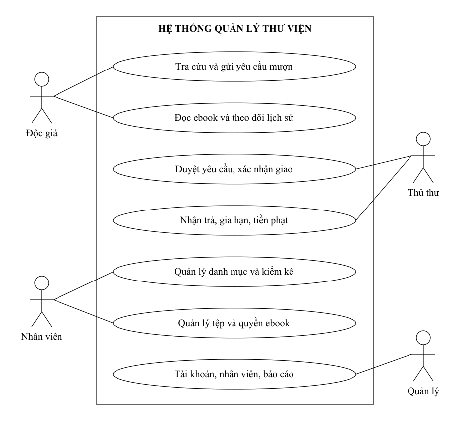

*Hình 4.1. Use Case các chức năng chính của hệ thống thư viện*

Các nhóm Use Case được tổng hợp để sơ đồ dễ đọc; danh mục đầy đủ và actor của từng mã nằm tại mục 3.6. Hệ thống mail là tác nhân hỗ trợ thông báo; cổng thanh toán chỉ thuộc hướng mở rộng theo phạm vi đã nêu.

## 4.2. Activity Diagram

## 4.2.1. Quy trình đăng ký mượn sách

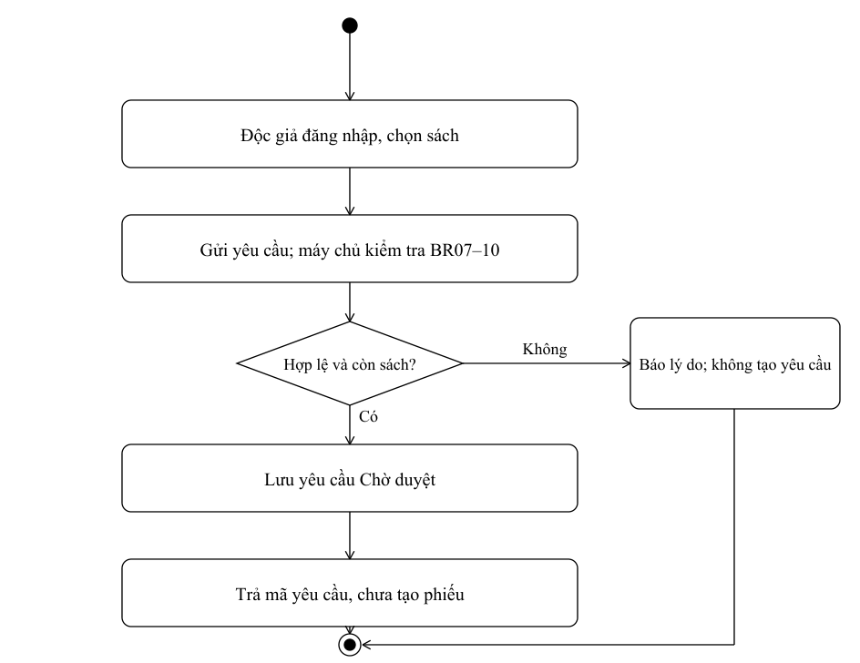

*Hình 4.2. Hoạt động đăng ký mượn sách*

Mục đích: ghi nhận nhu cầu mượn để thủ thư xét duyệt, không ghi nhận một lượt mượn thực tế ngay khi độc giả nhấn gửi. Mã yêu cầu giúp người dùng tra cứu trạng thái và tránh gửi lặp không cần thiết.

Nhánh không hợp lệ: hệ thống thông báo điều kiện chưa đáp ứng và không tạo yêu cầu. Nhánh lỗi lưu: giữ dữ liệu nhất quán, cho phép thử lại an toàn. Khả dụng hiển thị trên màn hình phải được kiểm tra lại tại máy chủ.

Mô tả hoạt động: độc giả chọn sách và gửi thông tin; hệ thống xác định người dùng từ phiên, kiểm tra định dạng, hạn mức và trạng thái khả dụng, sau đó lưu yêu cầu cùng các dòng chi tiết. Nếu có yêu cầu còn mở trùng nội dung, hiển thị yêu cầu hiện tại thay vì phát sinh bản ghi không cần thiết. Kết quả đầu ra là mã yêu cầu chờ duyệt hoặc thông báo từ chối.

Sau khi gửi thành công, độc giả theo dõi yêu cầu trong cổng cá nhân. Theo giả định TK04, yêu cầu chờ duyệt không giữ bản và không làm giảm tồn khả dụng. Khả dụng và hạn mức phải được kiểm tra lại trong transaction tại thời điểm giao.

## 4.2.2. Quy trình duyệt và giao sách

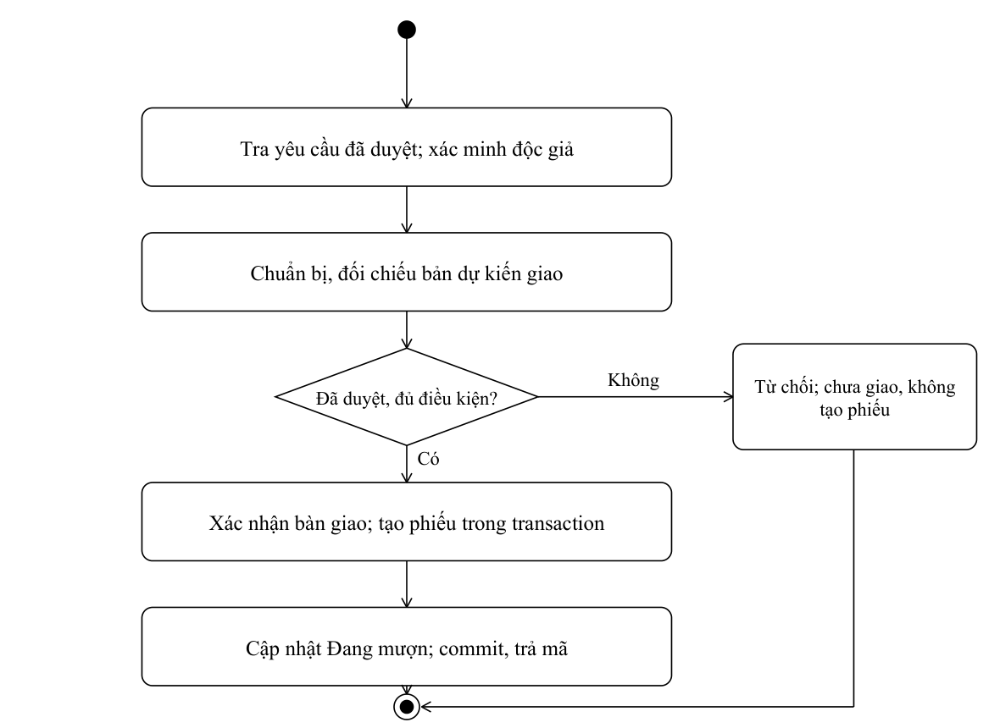

*Hình 4.3. Hoạt động duyệt và giao sách*

Nếu từ chối, lưu lý do và kết thúc; không tạo phiếu mượn. Nếu đã duyệt nhưng chưa giao, yêu cầu vẫn chưa trở thành khoản mượn thực tế theo BR10.

Mục đích của bước giao sách là xác nhận sự chuyển giao vật lý và thiết lập trách nhiệm mượn trả. Thủ thư kiểm tra đúng độc giả, đúng bản sách và điều kiện tại thời điểm bàn giao; hạn mức có thể đã thay đổi từ lúc yêu cầu được duyệt.

| Bước | Thao tác và kiểm soát |
| --- | --- |
| 1 | Tìm yêu cầu đã duyệt và xác minh độc giả |
| 2 | Đối chiếu từng bản sách thực tế |
| 3 | Kiểm tra tối đa 3 cuốn/lần và tổng đang mượn không quá 7 |
| 4 | Khóa/kiểm tra bản sách trong transaction |
| 5 | Tạo phiếu, dòng mượn, ngày mượn và hạn trả |
| 6 | Chuyển bản sách sang Đang mượn và commit |
| 7 | Thông báo mã phiếu và hạn trả sau thành công |

Khi có tranh chấp bản cuối, chỉ một giao dịch được thành công. Khi mất kết nối hoặc lỗi cập nhật, thao tác phải rollback và thủ thư được thông báo chưa hoàn tất. Hệ thống không tạo thêm phiếu khi nhận lại cùng một yêu cầu xác nhận.

Kết quả đầu ra: phiếu mượn được tạo sau bàn giao, các bản có trạng thái Đang mượn và hạn trả được hiển thị. Báo cáo áp dụng thời hạn tối đa 14 ngày theo bộ quy tắc đã xác nhận. Điều kiện tối thiểu bảy ngày trong một đặc tả cũ không được tự thêm thành điều kiện bắt buộc của phiên bản này.

## 4.2.3. Quy trình gia hạn sách

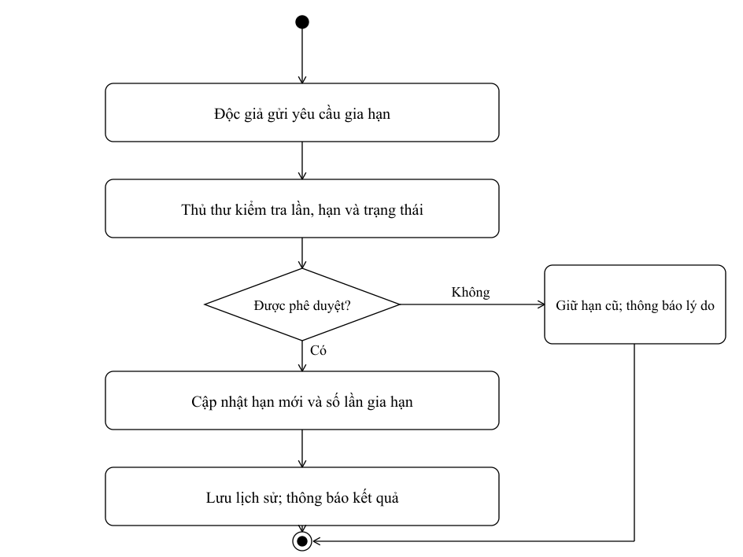

*Hình 4.4. Hoạt động gia hạn sách*

Một khoản mượn được gia hạn tối đa hai lần, mỗi lần thêm tối đa bảy ngày. Theo bộ quy tắc đã xác nhận, yêu cầu được xét khi trễ không quá một ngày và phải có thủ thư phê duyệt.

Gửi yêu cầu không tự làm thay đổi hạn trả. Chỉ sau khi thủ thư phê duyệt, hệ thống mới cập nhật ngày hạn mới và số lần gia hạn, đồng thời lưu người xử lý và thời điểm.

Kết quả đầu ra: yêu cầu có trạng thái đã duyệt hoặc bị từ chối. Khi duyệt, ghi hạn cũ, hạn mới, số lần, người duyệt và thời điểm. Việc xét gia hạn áp dụng khoản mượn đang mở và BR13–15 đã xác nhận; không dùng điều kiện “sách còn hàng” trong đặc tả cũ để thay thế điều kiện của khoản mượn.

## 4.2.4. Quy trình trả sách và tiền phạt

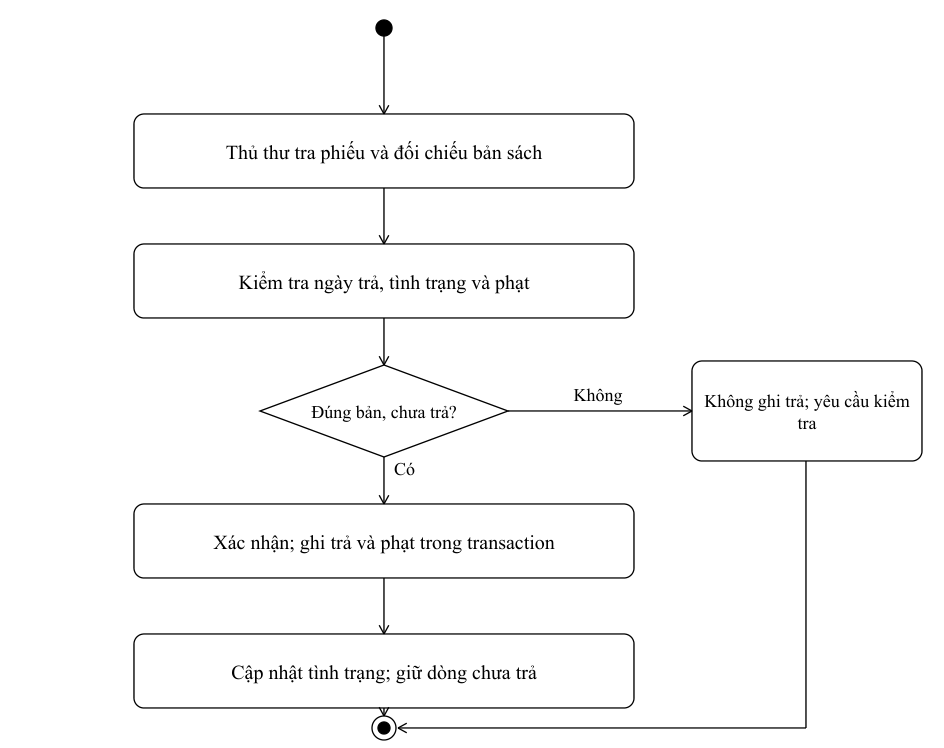

*Hình 4.5. Hoạt động trả sách và ghi nhận phạt*

Mỗi cuốn được xử lý riêng để hỗ trợ trả từng phần. Sách nguyên vẹn có thể trở lại khả dụng; sách mất hoặc hư hỏng được ghi nhận đúng tình trạng và không tự động đưa vào số lượng có thể cho mượn.

Công thức quá hạn cơ sở là 2.000 đồng nhân số ngày trễ của từng cuốn. Với nhiều sách có ngày trả khác nhau, hệ thống tính từng dòng rồi cộng; không dùng một số ngày chung nếu điều đó làm sai số tiền phải thu.

| Tình huống | Kết quả xử lý |
| --- | --- |
| Trả đúng hạn, nguyên vẹn | Ghi ngày trả, không phát sinh phạt quá hạn |
| Trả một phần | Chỉ đóng các dòng đã nhận; phiếu còn mở |
| Mất hoặc hư hỏng | Ghi sự cố, trạng thái và khoản bồi thường theo chính sách |
| Xác nhận lặp | Không tạo hai giao dịch trả hoặc hai khoản phạt |
| Thu tiền | Thu toàn bộ tại quầy theo BR19; lưu người xác nhận |
| Lỗi ghi dữ liệu | Rollback, không thông báo đã hoàn tất |

BR17 nêu bồi thường giá trị sách và một khoản phí theo quy định nhưng chưa chốt mức phí cụ thể. Vì vậy hệ thống cần tham số chính sách; báo cáo không tự chọn 50.000 hay 100.000 đồng làm mức phạt bắt buộc.

Mô tả hoạt động thu tiền: thủ thư mở khoản phạt đã xác nhận, đối chiếu số tiền và độc giả, nhận đủ tiền tại quầy rồi xác nhận đã thu. Hệ thống lưu bằng chứng và người xử lý, không ghi thu hai lần khi gửi lặp. Việc nhận sách thực tế và việc thu khoản phạt là hai sự kiện riêng; nguồn không quy định được giữ trạng thái Đang mượn chỉ vì tiền phạt chưa thanh toán.

## 4.2.5. Quy trình truy cập sách điện tử

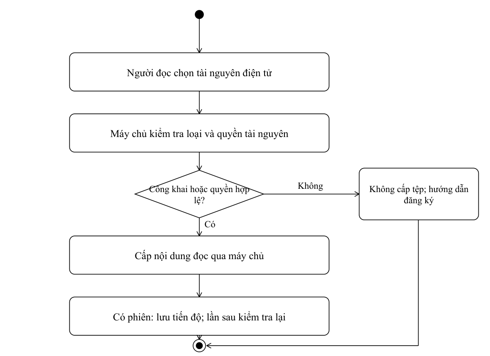

*Hình 4.6. Hoạt động truy cập sách điện tử*

Tài liệu công khai được đọc theo BR20. Tài liệu giới hạn yêu cầu đăng ký và phê duyệt; quyền đọc phải được kiểm tra mỗi lần truy cập, không chỉ khi mở màn hình đầu tiên.

Bộ quy tắc đã xác nhận cho phép tối đa ba sách điện tử mỗi lần, thời hạn 14 ngày. Khi hết thời hạn, hệ thống thu hồi quyền đọc. Nội dung ví dụ bảy ngày trong tài liệu cũ không được dùng làm quy tắc của báo cáo này.

| Tình huống | Hành vi cần có |
| --- | --- |
| Chưa được duyệt | Không trả nội dung tệp hạn chế |
| Quyền hết hạn | Từ chối quyền đọc mới, hướng dẫn đăng ký lại nếu được phép |
| Đổi ID ebook/tài khoản | Kiểm tra quyền trên chính tài nguyên được yêu cầu |
| Lưu tiến độ thất bại | Thông báo và cho phép thử lại |
| Tệp không tồn tại | Báo lỗi rõ ràng; không để lộ đường dẫn máy chủ |
| Đọc công khai | Không áp dụng sai hạn mức mượn tài nguyên giới hạn |

Các chức năng tủ sách cá nhân, yêu thích và lịch sử đọc hỗ trợ trải nghiệm độc giả. Mỗi dữ liệu phải gắn với tài khoản hiện tại; quyền thay đổi tệp và chính sách truy cập thuộc vai trò quản lý được cấp phép.

Sách công khai được đọc không cần phiên theo giả định thiết kế TK03 ở mục 3.11; tiến độ, tủ sách và lịch sử chỉ lưu khi có tài khoản. Sách giới hạn phải có quyền còn hiệu lực. Đây là lựa chọn thiết kế bổ sung, không phải chức năng đã triển khai.

## 4.3. Use Case chi tiết nghiệp vụ lưu thông

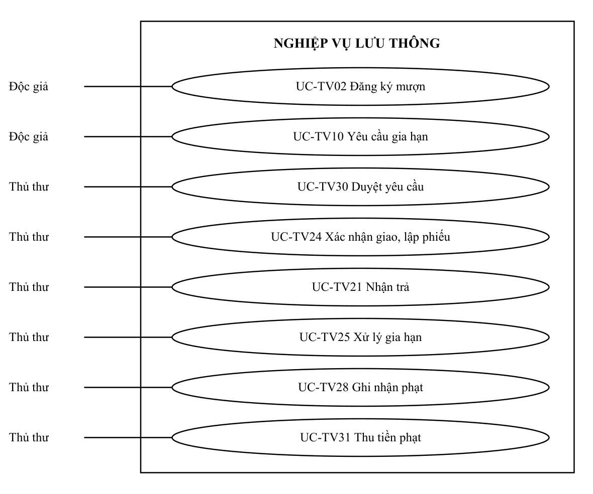

*Use Case chi tiết lưu thông và tác nhân*

Các nhãn tác nhân lặp lại chỉ cùng một vai trò. Quan hệ nối là association, không dùng include/extend để biểu diễn thứ tự thời gian. Thứ tự gửi → duyệt → giao được quy định bằng tiền/hậu điều kiện và Activity Diagram; UC21 và UC31 là hai sự kiện riêng. Sơ đồ này chi tiết nhóm trọng tâm; các UC khác truy vết đầy đủ ở mục 3.8–3.9.

# CHƯƠNG 5. THIẾT KẾ HỆ THỐNG

## 5.1. Class Diagram

*Hình 5.1. Các lớp nghiệp vụ cốt lõi (mô hình tổng hợp)*

## 5.2. Quan hệ các lớp

## 5.2.1. Quan hệ kế thừa

Vai trò có thể được biểu diễn bằng thuộc tính của TaiKhoan và kiểm tra RBAC. Không bắt buộc tạo lớp con cho từng vai trò; DocGia và NhanVien là hồ sơ liên kết với tài khoản. Mô hình này tránh nhầm kế thừa đối tượng với khóa ngoại trong cơ sở dữ liệu.

## 5.2.2. Quan hệ liên kết

| Quan hệ | Ý nghĩa |
| --- | --- |
| Sach 1–N BanSach | Đầu sách và bản vật lý |
| DocGia 1–N YeuCauMuon | Người gửi yêu cầu |
| YeuCauMuon 1–0..1 PhieuMuon | Chỉ tạo phiếu sau bàn giao; FK UNIQUE |
| PhieuMuon 1–N ChiTietMuon | Mỗi dòng ứng với một bản sách |
| BanSach 1–N ChiTietMuon | Lịch sử mượn; tối đa một dòng đang mở |
| DocGia 1–N PhieuPhat | Chủ thể chịu phạt; liên kết bổ sung trong ERD đích |
| PhieuPhat 1–N ChiTietPhieuPhat | Phiếu có nhiều khoản vi phạm |
| ChiTietMuon 1–N ChiTietPhieuPhat | Mỗi khoản vi phạm truy tới một dòng mượn |
| ChiTietMuon 1–N GiaHan | Lịch sử yêu cầu và quyết định gia hạn |
| Ebook 1–N QuyenDoc | Phân hệ riêng ở mục 5.4.7 |

Kiến trúc ba tầng đặt quy tắc tại Service và truy vấn tại Repository. Controller không tự viết thuật toán tính phạt hoặc ghép chuỗi SQL. Những quan hệ ở sơ đồ tổng hợp là định hướng logic, cần ánh xạ nhất quán sang schema khi lập trình.

Quan hệ kế thừa không được suy ra từ tên vai trò. Thiết kế Lab 6 dùng TaiKhoan.role và hồ sơ Doc_gia/NhanVien; vì vậy sơ đồ tổng hợp sử dụng liên kết và RBAC. Nếu hiện thực lớp con, nhóm phải chứng minh hành vi chung và khả năng thay thế, không sao chép cây NguoiDung–NhanVien của chủ đề khác.

## 5.3. Sequence Diagram

## 5.3.1. Quy trình đăng ký mượn sách

Độc giả gửi yêu cầu qua giao diện; Controller lấy định danh từ phiên, Service kiểm tra điều kiện và Repository lưu yêu cầu. Phản hồi thành công chỉ được trả sau khi lưu hoàn tất.

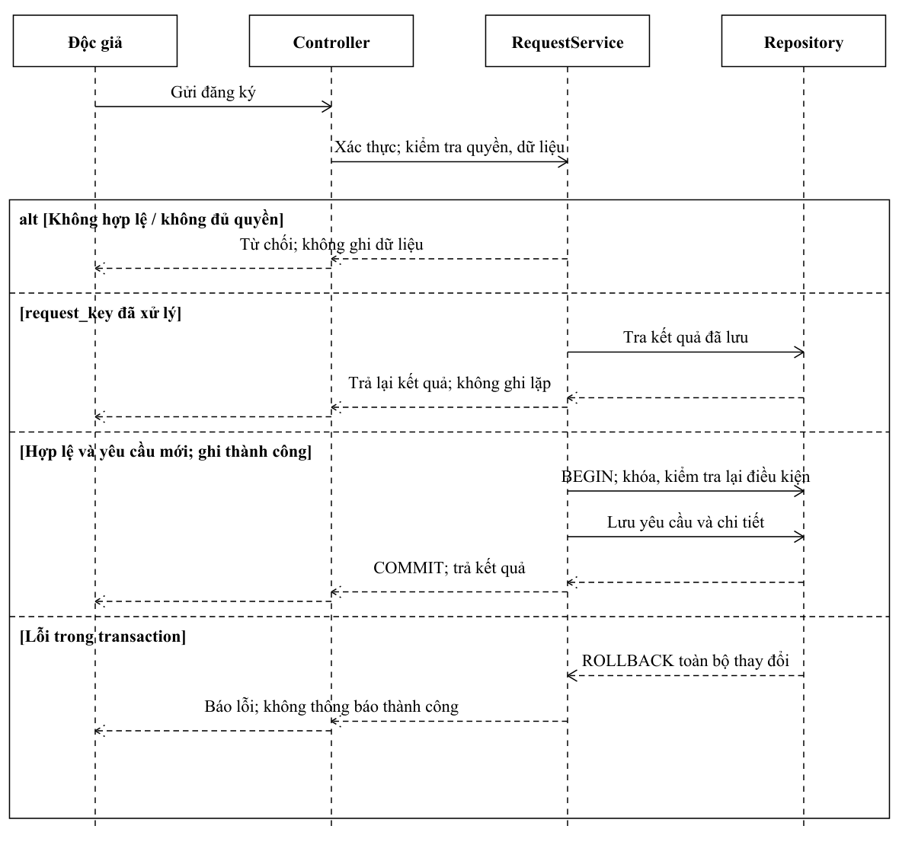

*Hình 5.2. Tuần tự đăng ký mượn sách*

## 5.3.2. Quy trình giao sách

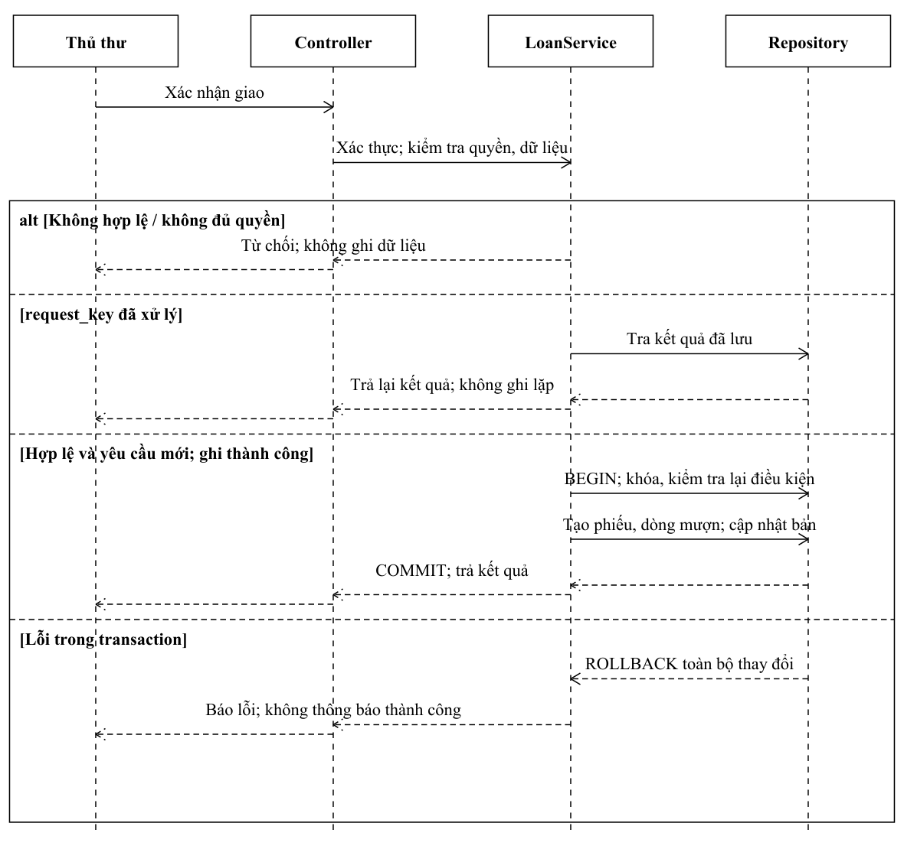

*Hình 5.3. Tuần tự xác nhận giao sách*

## 5.3.3. Quy trình trả sách và tiền phạt

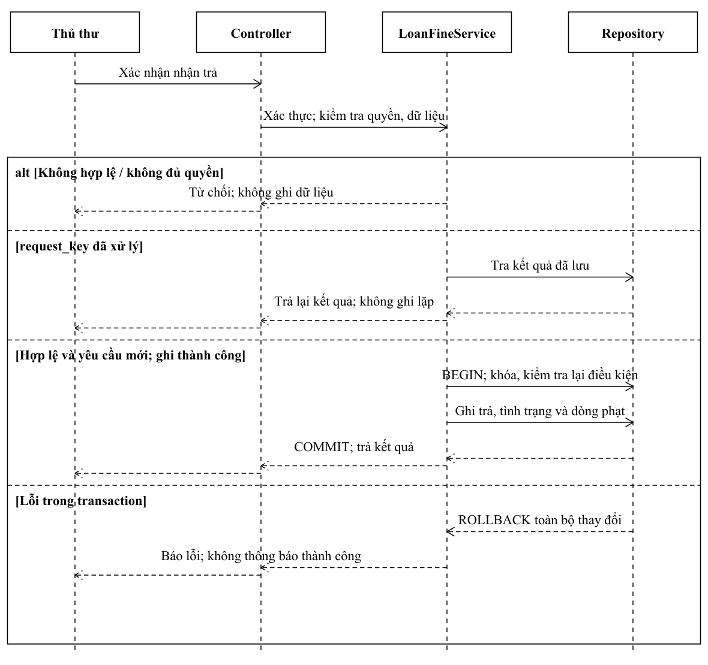

*Hình 5.4. Tuần tự trả sách và tiền phạt*

## 5.4. Thiết kế cơ sở dữ liệu

## 5.4.1. Xác định các thực thể

| Nhóm | Thực thể |
| --- | --- |
| Người dùng | TaiKhoan, Doc_gia, NhanVien, The_doc_gia |
| Danh mục | Sach, Tac_gia, The_loai, Nha_xuat_ban, Vi_tri_luu_tru |
| Lưu thông | Phieu_muon, Chi_tiet_phieu_muon |
| Vi phạm | Phieu_phat, Chi_tiet_phieu_phat |

Đây là các bảng trong Lab 6. Mô hình cần bổ sung lớp dữ liệu bản sách, yêu cầu mượn và quyền ebook để đáp ứng đầy đủ các quy tắc chi tiết.

## 5.4.2. Sơ đồ ERD

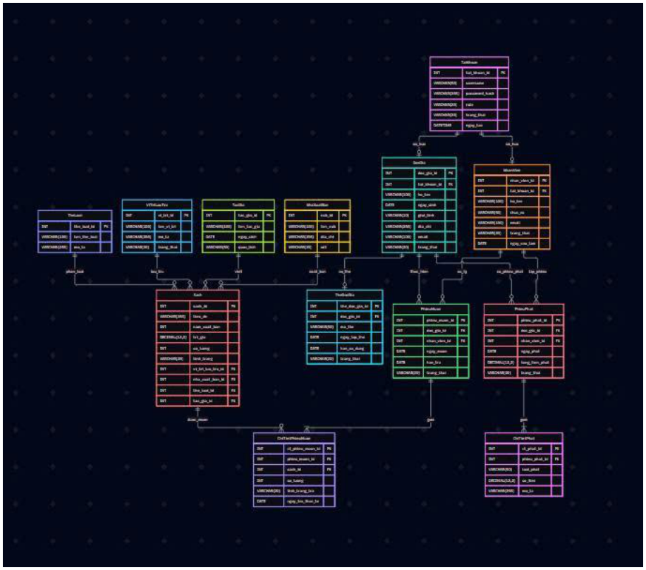

*Hình 5.5. ERD trong tài liệu thiết kế Lab 6 [5]*

ERD được giữ từ tài liệu thiết kế của nhóm để thể hiện đúng mức độ đã có. Sơ đồ này chưa phản ánh đầy đủ bản sách riêng, yêu cầu chờ duyệt và quyền đọc ebook; các phần bổ sung dưới đây là đề xuất hoàn thiện, không phải schema đã triển khai.

## 5.4.3. Phân tích quan hệ

| Quan hệ hiện có | Phân tích |
| --- | --- |
| TaiKhoan – Doc_gia/NhanVien | Hồ sơ tham chiếu tài khoản; cần UNIQUE để không gắn trùng |
| Danh mục – Sach | Tác giả, thể loại, NXB và vị trí liên kết qua FK |
| Doc_gia – Phieu_muon | Một độc giả có nhiều phiếu theo thời gian |
| NhanVien – Phieu_muon | Lưu nhân viên xác nhận giao |
| Phieu_muon – Chi_tiet_phieu_muon | Một phiếu có nhiều dòng; mỗi dòng có ngày trả thực tế |
| Phieu_phat – Chi_tiet_phieu_phat | Tách tổng phiếu và từng nguyên nhân vi phạm |

Thiết kế hiện tại gắn số lượng và tình trạng vào đầu sách. BR04 yêu cầu định danh từng bản, nên cần bảng BanSach và tham chiếu từ dòng mượn đến bản sách cụ thể. Nếu không, việc trả từng cuốn, mất hoặc hư hỏng một bản sẽ khó đối chiếu chính xác.

Tương tự, yêu cầu mượn phải tách khỏi phiếu mượn. Việc duyệt không được dùng trực tiếp để tạo phiếu nếu chưa giao sách; dữ liệu cần lưu trạng thái, người duyệt, lý do và thời điểm.

## 5.4.4. Data Dictionary

Từ điển dưới đây giữ đầy đủ 13 bảng của Lab 6, chuẩn hóa tên theo phần Data dictionary. PK định danh duy nhất; FK liên kết bản ghi. Các ràng buộc không âm, ngày hợp lệ và trạng thái là điều kiện cần kiểm tra khi hiện thực [5].

## Bảng TaiKhoan

| Thuộc tính | Kiểu dữ liệu | Ràng buộc | Ý nghĩa |
| --- | --- | --- | --- |
| tai_khoan_id | INT | PK, NOT NULL | Mã tài khoản |
| username | VARCHAR(50) | UNIQUE, NOT NULL | Tên đăng nhập |
| password_hash | VARCHAR(255) | NOT NULL | Mật khẩu đã băm |
| role | VARCHAR(20) | NOT NULL | Một vai trò chính |
| trang_thai | VARCHAR(20) | NOT NULL | Trạng thái tài khoản |
| ngay_tao | DATETIME | NOT NULL | Thời điểm tạo |

## Bảng Doc_gia

| Thuộc tính | Kiểu dữ liệu | Ràng buộc | Ý nghĩa |
| --- | --- | --- | --- |
| doc_gia_id | INT | PK | Mã độc giả |
| tai_khoan_id | INT | FK, UNIQUE | Tham chiếu TaiKhoan |
| ho_ten | VARCHAR(100) | NOT NULL | Họ tên |
| ngay_sinh | DATE | NULL | Ngày sinh |
| gioi_tinh | VARCHAR(10) | NULL | Giới tính |
| dia_chi | VARCHAR(255) | NULL | Địa chỉ |
| email | VARCHAR(100) | NULL | Email liên hệ |
| trang_thai | VARCHAR(20) | NOT NULL | Trạng thái hồ sơ |

BR01 yêu cầu một tài khoản cho mỗi sinh viên. Schema nguồn chưa có mã sinh viên; cần bổ sung thuộc tính ma_sinh_vien và ràng buộc duy nhất khi hoàn thiện, không chỉ dựa vào họ tên hoặc email để chống trùng.

## Bảng NhanVien

| Thuộc tính | Kiểu dữ liệu | Ràng buộc | Ý nghĩa |
| --- | --- | --- | --- |
| nhan_vien_id | INT | PK | Mã nhân viên |
| tai_khoan_id | INT | FK, UNIQUE | Tham chiếu TaiKhoan |
| ho_ten | VARCHAR(100) | NOT NULL | Họ tên |
| chuc_vu | VARCHAR(50) | NOT NULL | Chức vụ |
| email | VARCHAR(100) | NULL | Email liên hệ |
| trang_thai | VARCHAR(20) | NOT NULL | Trạng thái làm việc |
| ngay_vao_lam | DATE | NULL | Ngày vào làm |

## Bảng Sach

| Thuộc tính | Kiểu dữ liệu | Ràng buộc | Ý nghĩa |
| --- | --- | --- | --- |
| sach_id | INT | PK | Mã đầu sách |
| tieu_de | VARCHAR(255) | NOT NULL | Tên sách |
| nam_xuat_ban | INT | NULL | Năm xuất bản |
| tri_gia | DECIMAL(12,2) | Không âm | Giá trị sách |
| so_luong | INT | Không âm | Số lượng tổng hợp |
| tinh_trang | VARCHAR(20) | NOT NULL | Tình trạng theo nguồn |
| vi_tri_luu_tru_id | INT | FK | Vi_tri_luu_tru.vi_tri_id |
| nha_xuat_ban_id | INT | FK | Nha_xuat_ban.nxb_id |
| the_loai_id | INT | FK | The_loai.the_loai_id |
| tac_gia_id | INT | FK | Tac_gia.tac_gia_id |

Phần mô tả NhanVien ở đầu Lab 6 bị lặp trường của độc giả; bảng này dùng định nghĩa nhan_vien_id trong Data dictionary. Số lượng và tình trạng trên Sach chưa thay thế được thông tin từng bản sách theo BR04.

## Bảng Tac_gia

| Thuộc tính | Kiểu dữ liệu | Ràng buộc | Ý nghĩa |
| --- | --- | --- | --- |
| tac_gia_id | INT | PK | Mã tác giả |
| ten_tac_gia | VARCHAR(100) | NOT NULL | Tên tác giả |
| ngay_sinh | DATE | NULL | Ngày sinh |
| quoc_tich | VARCHAR(50) | NULL | Quốc tịch |

## Bảng The_loai

| Thuộc tính | Kiểu dữ liệu | Ràng buộc | Ý nghĩa |
| --- | --- | --- | --- |
| the_loai_id | INT | PK | Mã thể loại |
| ten_the_loai | VARCHAR(100) | NOT NULL | Tên thể loại |
| mo_ta | VARCHAR(255) | NULL | Mô tả |

## Bảng Nha_xuat_ban

| Thuộc tính | Kiểu dữ liệu | Ràng buộc | Ý nghĩa |
| --- | --- | --- | --- |
| nxb_id | INT | PK | Mã nhà xuất bản |
| ten_nxb | VARCHAR(100) | NOT NULL | Tên nhà xuất bản |
| dia_chi | VARCHAR(255) | NULL | Địa chỉ |
| sdt | VARCHAR(20) | NULL | Điện thoại, giữ số 0 đầu |

## Bảng Vi_tri_luu_tru

| Thuộc tính | Kiểu dữ liệu | Ràng buộc | Ý nghĩa |
| --- | --- | --- | --- |
| vi_tri_id | INT | PK | Mã vị trí |
| ten_vi_tri | VARCHAR(100) | NOT NULL | Tên kệ/vị trí |
| mo_ta | VARCHAR(255) | NULL | Mô tả vị trí |
| trang_thai | VARCHAR(20) | NOT NULL | Trạng thái sử dụng |

Không xóa danh mục đang được tham chiếu nếu làm mất quan hệ. Cách hiện thực có thể dùng ngừng sử dụng hoặc kiểm tra liên kết trước khi xóa; quy tắc này cần thống nhất với luồng UC-TV37.

## Bảng The_doc_gia

| Thuộc tính | Kiểu dữ liệu | Ràng buộc | Ý nghĩa |
| --- | --- | --- | --- |
| the_doc_gia_id | INT | PK | Mã thẻ |
| doc_gia_id | INT | FK, NOT NULL | Độc giả sở hữu |
| ma_the | VARCHAR(50) | UNIQUE, NOT NULL | Mã thẻ hiển thị |
| ngay_lap_the | DATE | NOT NULL | Ngày lập |
| han_su_dung | DATE | NOT NULL | Hạn thẻ |
| trang_thai | VARCHAR(20) | NOT NULL | Hiệu lực thẻ |

## Bảng Phieu_muon

| Thuộc tính | Kiểu dữ liệu | Ràng buộc | Ý nghĩa |
| --- | --- | --- | --- |
| phieu_muon_id | INT | PK | Mã phiếu |
| doc_gia_id | INT | FK, NOT NULL | Độc giả nhận sách |
| nhan_vien_id | INT | FK, NOT NULL | Nhân viên giao sách |
| ngay_muon | DATE | NOT NULL | Ngày xác nhận giao |
| han_tra | DATE | NOT NULL | Hạn trả ban đầu |
| trang_thai | VARCHAR(20) | NOT NULL | Trạng thái phiếu |

ngay_muon phản ánh xác nhận giao, không phải thời điểm gửi yêu cầu. Hạn mượn ban đầu tối đa 14 ngày theo bộ quy tắc đã xác nhận. Trạng thái hoàn tất phải suy ra từ toàn bộ dòng mượn, không đóng phiếu khi mới nhận một phần sách.

Ràng buộc hạn thẻ và tình trạng độc giả cần được kiểm tra tại thời điểm xử lý. Nếu chính sách yêu cầu thẻ còn hiệu lực để mượn, điều kiện này phải được chốt trong BR và kiểm thử tương ứng thay vì chỉ dựa vào sự tồn tại của bản ghi thẻ.

## Bảng Chi_tiet_phieu_muon

| Thuộc tính | Kiểu dữ liệu | Ràng buộc | Ý nghĩa |
| --- | --- | --- | --- |
| ct_phieu_muon_id | INT | PK | Mã dòng mượn |
| phieu_muon_id | INT | FK, NOT NULL | Phiếu chứa dòng |
| sach_id | INT | FK, NOT NULL | Đầu sách trong ERD nguồn |
| so_luong | INT | Lớn hơn 0 | Số lượng mượn |
| tinh_trang_tra | VARCHAR(20) | NULL khi chưa trả | Tình trạng khi nhận |
| ngay_tra_thuc_te | DATE | NULL khi chưa trả | Ngày nhận lại |

## Bảng Phieu_phat

| Thuộc tính | Kiểu dữ liệu | Ràng buộc | Ý nghĩa |
| --- | --- | --- | --- |
| phieu_phat_id | INT | PK | Mã phiếu phạt |
| doc_gia_id | INT | FK, NOT NULL | Độc giả bị phạt |
| nhan_vien_id | INT | FK, NOT NULL | Nhân viên xác nhận |
| ngay_phat | DATE | NOT NULL | Ngày ghi nhận |
| tong_tien_phat | DECIMAL(12,2) | Không âm | Tổng tiền phải thu |
| trang_thai | VARCHAR(20) | NOT NULL | Chưa thu/đã thu |

Để trả từng cuốn và tính phạt theo ngày trả khác nhau, thiết kế hoàn thiện cần một dòng cho từng bản sách, hoặc mô hình giao nhận có thể truy vết tới bản cụ thể. Giữ ngay_tra_thuc_te là NULL cho sách chưa nhận; không tự ghi ngày hiện tại để làm đầy dữ liệu.

Nếu gia hạn từng cuốn, lưu han_tra_hieu_luc và so_lan_gia_han theo dòng mượn. Mỗi lần duyệt phải ghi hạn cũ, hạn mới, người duyệt và thời điểm để đối chiếu số ngày quá hạn về sau.

## Bảng Chi_tiet_phieu_phat

| Thuộc tính | Kiểu dữ liệu | Ràng buộc | Ý nghĩa |
| --- | --- | --- | --- |
| ct_phat_id | INT | PK | Mã dòng phạt |
| phieu_phat_id | INT | FK, NOT NULL | Phiếu chứa khoản phạt |
| loai_phat | VARCHAR(50) | NOT NULL | Quá hạn, mất, hư hỏng |
| so_tien | DECIMAL(12,2) | Không âm | Tiền của vi phạm |
| mo_ta | VARCHAR(255) | NULL | Diễn giải vi phạm |

| Phần bổ sung thiết kế | Thuộc tính/quan hệ tối thiểu |
| --- | --- |
| BanSach | ban_sach_id, sach_id, ma_ban UNIQUE, tinh_trang, vi_tri_id |
| YeuCauMuon và chi tiết | yeu_cau_id, doc_gia_id, trạng thái, người duyệt; sách và số lượng |
| GiaHan | Dòng mượn, hạn cũ/mới, số lần, người và thời điểm duyệt |
| Ebook, TepEbook, QuyenDoc | Đầu sách, tệp, chế độ truy cập; tài khoản, hiệu lực và hết hạn |
| ThanhToanPhat | Phiếu phạt, số tiền đủ, người thu, thời điểm, định danh chống lặp |
| Lịch sử cá nhân | Yêu thích, tiến độ đọc, thông báo và nhật ký theo tài khoản |

Các cấu trúc bổ sung được đề xuất để đáp ứng BR và UC, chưa phải bảng đã tồn tại trong schema nguồn. Khoản phạt cần liên kết dòng mượn/sự cố và phiên bản chính sách; thay đổi giá trị danh mục không được âm thầm sửa số tiền đã xác nhận.

## 5.4.5. Khóa chính, khóa ngoại và ràng buộc dữ liệu

## Khóa chính (PK)

| Bảng | Khóa chính | Mục đích |
| --- | --- | --- |
| TaiKhoan | tai_khoan_id | Mã tài khoản |
| Doc_gia | doc_gia_id | Mã độc giả |
| NhanVien | nhan_vien_id | Mã nhân viên |
| Sach | sach_id | Mã đầu sách |
| Tac_gia | tac_gia_id | Mã tác giả |
| The_loai | the_loai_id | Mã thể loại |
| Nha_xuat_ban | nxb_id | Mã nhà xuất bản |
| Vi_tri_luu_tru | vi_tri_id | Mã vị trí |
| The_doc_gia | the_doc_gia_id | Mã thẻ |
| Phieu_muon | phieu_muon_id | Mã phiếu |
| Chi_tiet_phieu_muon | ct_phieu_muon_id | Mã dòng mượn |
| Phieu_phat | phieu_phat_id | Mã phiếu phạt |
| Chi_tiet_phieu_phat | ct_phat_id | Mã dòng phạt |

PK bảo đảm mỗi bản ghi được định danh duy nhất. UNIQUE được dùng cho username, mã thẻ và các định danh nghiệp vụ; khóa ngoại bảo vệ quan hệ giữa hồ sơ, sách và giao dịch. Một khóa ghép của phiếu và sách không tự ngăn hai phiếu khác nhau cùng giao bản cuối.

## Khóa ngoại (FK)

Các FK chính được liệt kê ở trang tiếp theo. Chính sách xóa cần bảo toàn lịch sử mượn trả và tiền phạt; không xóa dây chuyền các giao dịch chỉ vì ngừng sử dụng một tài khoản hoặc một đầu sách.

| Bảng | Khóa ngoại | Tham chiếu |
| --- | --- | --- |
| Doc_gia / NhanVien | tai_khoan_id | TaiKhoan.tai_khoan_id |
| Sach | tac_gia_id | Tac_gia.tac_gia_id |
| Sach | the_loai_id | The_loai.the_loai_id |
| Sach | nha_xuat_ban_id | Nha_xuat_ban.nxb_id |
| Sach | vi_tri_luu_tru_id | Vi_tri_luu_tru.vi_tri_id |
| The_doc_gia | doc_gia_id | Doc_gia.doc_gia_id |
| Phieu_muon | doc_gia_id | Doc_gia.doc_gia_id |
| Phieu_muon | nhan_vien_id | NhanVien.nhan_vien_id |
| Chi_tiet_phieu_muon | phieu_muon_id | Phieu_muon.phieu_muon_id |
| Chi_tiet_phieu_muon | sach_id | Sach.sach_id |
| Phieu_phat | doc_gia_id | Doc_gia.doc_gia_id |
| Phieu_phat | nhan_vien_id | NhanVien.nhan_vien_id |
| Chi_tiet_phieu_phat | phieu_phat_id | Phieu_phat.phieu_phat_id |

## Các ràng buộc dữ liệu

| Ràng buộc | Quy tắc |
| --- | --- |
| NOT NULL | Thông tin bắt buộc: tài khoản, tên sách, người mượn, ngày giao. |
| UNIQUE | Username, mã thẻ, mã bản sách và mã sinh viên khi bổ sung. |
| CHECK / Service | Số lượng dương, tiền không âm; hạn và trạng thái đúng chính sách. |
| Transaction | Giao/nhận sách cập nhật đầy đủ hoặc rollback; không ghi dở dang. |
| Idempotency | Cùng xác nhận giao/trả/thu không sinh nhiều giao dịch. |

## 5.4.6. Quan hệ giữa các bảng

| Bảng A | Bảng B | Quan hệ | Giải thích |
| --- | --- | --- | --- |
| TaiKhoan | Doc_gia / NhanVien | 1–0..1 | Liên kết hồ sơ qua FK UNIQUE |
| Tac_gia | Sach | 1–N | Mô hình nguồn gắn một tác giả/đầu sách |
| The_loai | Sach | 1–N | Phân loại đầu sách |
| Nha_xuat_ban | Sach | 1–N | Nhà xuất bản của đầu sách |
| Vi_tri_luu_tru | Sach | 1–N | Vị trí trong mô hình nguồn |
| Doc_gia | The_doc_gia | 1–N | Lịch sử thẻ; chính sách thẻ hiện hành cần chốt |
| Doc_gia | Phieu_muon | 1–N | Các lượt mượn theo thời gian |
| NhanVien | Phieu_muon | 1–N | Nhân viên xử lý nhiều lượt giao |
| Phieu_muon | Chi_tiet_phieu_muon | 1–N | Các dòng mượn trong phiếu |
| Sach | Chi_tiet_phieu_muon | 1–N | Lịch sử mượn đầu sách theo nguồn |
| Doc_gia / NhanVien | Phieu_phat | 1–N | Người chịu phạt / người lập |
| Phieu_phat | Chi_tiet_phieu_phat | 1–N | Các nguyên nhân và khoản tiền |
| Sach | BanSach (bổ sung) | 1–N | Theo dõi bản vật lý riêng |
| BanSach | Dòng mượn (bổ sung) | 1–N | Lịch sử; tối đa một dòng đang mở |
| Ebook | QuyenDoc (bổ sung) | 1–N | Quyền có hiệu lực theo tài khoản |

ERD nguồn tại mục 5.4.2 là bản thiết kế nguồn. Các mục bổ sung trong bảng được ghi rõ để không nhầm với schema đã có. Tính nhất quán phải được kiểm tra khi chuyển sang mã SQL và migration thực tế.

## 5.4.7. Mô hình dữ liệu đích và ánh xạ lớp

Mô hình đích là thiết kế đề xuất để triển khai, không phải database đã chạy. Giữ các bảng danh mục, tài khoản, hồ sơ của Lab 6; thay chi tiết mượn theo đầu sách bằng chi tiết theo từng bản vật lý. Tên lớp rút gọn ở Class Diagram ánh xạ sang tên bảng theo bảng dưới đây.

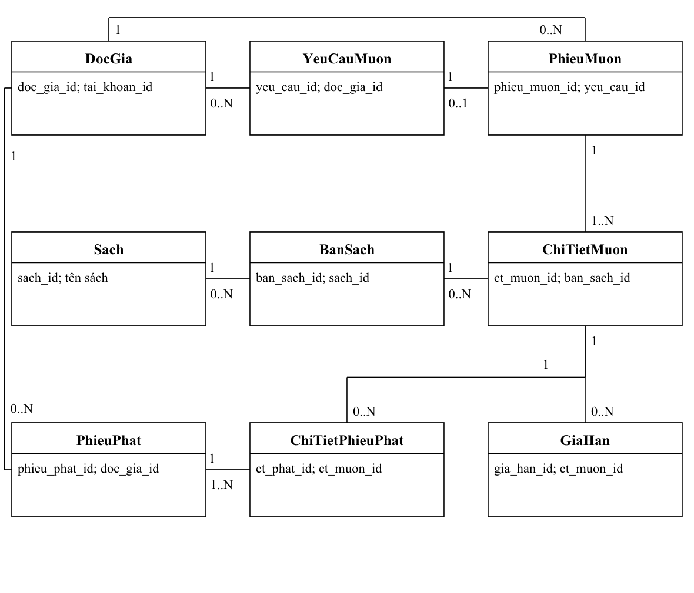

*Mô hình dữ liệu đích phần lưu thông*

ERD đích thể hiện liên kết theo bản sách và từng dòng mượn. Mỗi dòng phạt thuộc một phiếu phạt và truy tới một dòng mượn; một phiếu có thể chứa nhiều dòng vi phạm. Không nối trực tiếp cả phiếu phạt với duy nhất một dòng mượn. PhieuMuon và PhieuPhat đều tham chiếu Doc_gia.

| Tên lớp | Tên bảng đích |
| --- | --- |
| DocGia / PhieuMuon | Doc_gia / Phieu_muon |
| ChiTietMuon | Chi_tiet_phieu_muon |
| PhieuPhat / ChiTietPhieuPhat | Phieu_phat / Chi_tiet_phieu_phat |
| Sach / BanSach / YeuCauMuon / GiaHan | Giữ tên lớp làm tên bảng |

## 5.4.7. Mô hình dữ liệu đích (tiếp)

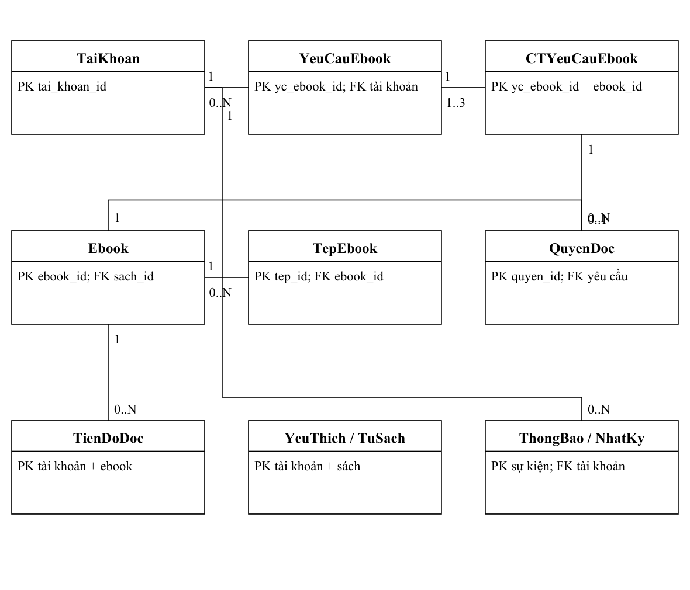

*Mô hình dữ liệu đích phần tài nguyên số*

Các đường nối thể hiện quan hệ chính; mỗi yêu cầu có 1–3 dòng ebook và mỗi dòng được cấp tối đa một quyền. QuyenDoc tham chiếu CTYeuCauEbook đã duyệt, TaiKhoan và Ebook; TienDoDoc tham chiếu tài khoản và ebook; YeuThich/TuSach tham chiếu tài khoản và sách. ThongBao, NhatKy và LichSuDoc có FK tài khoản; LichSuDoc thêm FK ebook. Không đặt FK từ tài khoản sang dữ liệu cá nhân. Chi tiết khóa và điều kiện ở mục 5.4.8.

TaiKhoan–Doc_gia/NhanVien tiếp tục dùng FK UNIQUE của schema nguồn. Với bản sách vật lý, hạn mức đếm dòng mượn đang mở; quyền ebook không cộng vào hạn mức 7 cuốn vật lý. Không dùng một bảng tổng số lượng thay cho lịch sử từng bản.

## 5.4.8. Từ điển dữ liệu phần hoàn thiện

PK: khóa chính; FK: khóa ngoại. Các bảng “sửa” thay thế cấu trúc tương ứng của mô hình nguồn khi triển khai mô hình đích. Kiểu ID dùng INT; thời điểm dùng DATETIME; tiền DECIMAL(12,2); nội dung và trạng thái dùng VARCHAR phù hợp.

| Bảng | Thuộc tính và khóa | Ràng buộc |
| --- | --- | --- |
| BanSach | ban_sach_id PK; sach_id FK; ma_ban UNIQUE; tinh_trang; vi_tri_id FK | Trạng thái BR05; chỉ khả dụng được giao; cấm xóa khi còn dòng mở. |
| YeuCauMuon | yeu_cau_id PK; doc_gia_id FK; trang_thai; nguoi_duyet FK; thoi_diem_duyet; ly_do | Chờ duyệt/đã duyệt/từ chối/đã giao; người duyệt là thủ thư. |
| ChiTietYeuCauMuon | yeu_cau_id + sach_id PK/FK; so_luong | Số lượng > 0; tổng yêu cầu ≤ 3. Chưa gán bản khi chờ duyệt. |
| Phieu_muon (sửa) | yeu_cau_id FK UNIQUE; doc_gia_id FK; nhan_vien_id FK; ngay_muon | Tạo lúc giao; một yêu cầu tối đa một phiếu. Ngày và chủ thể phải khớp yêu cầu. |

Ràng buộc nhiều bảng thực hiện trong Service/transaction. Khóa bản sách và bản ghi độc giả trước kiểm tra hạn mức; kiểm tra lặp bằng request_key. Không dùng UNIQUE(ban_sach_id) trên toàn bộ lịch sử mượn. Kiểm tra không có dòng mở thứ hai trong transaction hoặc dùng ràng buộc có điều kiện phù hợp hệ quản trị.

## 5.4.8. Từ điển dữ liệu phần hoàn thiện (tiếp)

PK: khóa chính; FK: khóa ngoại. Các bảng “sửa” thay thế cấu trúc tương ứng của mô hình nguồn khi triển khai mô hình đích. Kiểu ID dùng INT; thời điểm dùng DATETIME; tiền DECIMAL(12,2); nội dung và trạng thái dùng VARCHAR phù hợp.

| Bảng | Thuộc tính và khóa | Ràng buộc |
| --- | --- | --- |
| Chi_tiet_phieu_muon (sửa) | ct_muon_id PK; phieu_muon_id FK; ban_sach_id FK; han_tra_hieu_luc; so_lan_gia_han; ngay_tra_thuc_te NULL | Một dòng = một bản; bỏ so_luong hoặc cố định 1. Tối đa một dòng đang mở/bản; số lần gia hạn 0..2. |
| GiaHan | gia_han_id PK; ct_muon_id FK; han_cu; han_moi; trang_thai; nguoi_duyet FK; thoi_diem | Hạn mới > hạn cũ và ≤ hạn cũ + 7 ngày; kiểm tra trễ ≤ 1 ngày và cập nhật nguyên tử. |
| Chi_tiet_phieu_phat (sửa) | ct_phat_id PK; phieu_phat_id FK; ct_muon_id FK; loai_phat; so_tien; policy_version; tu_ngay; den_ngay | Người mượn khớp người chịu phạt; không ghi hai lần cùng vi phạm/khoảng tính. |
| ThanhToanPhat | thanh_toan_id PK; phieu_phat_id FK UNIQUE; so_tien; nguoi_thu FK; thoi_diem; request_key UNIQUE | Thu đúng toàn bộ tiền chưa thu; ghi thanh toán và trạng thái trong cùng transaction. |

Ràng buộc nhiều bảng thực hiện trong Service/transaction. Khóa bản sách và bản ghi độc giả trước kiểm tra hạn mức; kiểm tra lặp bằng request_key. Không dùng UNIQUE(ban_sach_id) trên toàn bộ lịch sử mượn. Kiểm tra không có dòng mở thứ hai trong transaction hoặc dùng ràng buộc có điều kiện phù hợp hệ quản trị.

## 5.4.8. Từ điển dữ liệu phần hoàn thiện (tiếp)

PK: khóa chính; FK: khóa ngoại. Các bảng “sửa” thay thế cấu trúc tương ứng của mô hình nguồn khi triển khai mô hình đích. Kiểu ID dùng INT; thời điểm dùng DATETIME; tiền DECIMAL(12,2); nội dung và trạng thái dùng VARCHAR phù hợp.

| Bảng | Thuộc tính và khóa | Ràng buộc |
| --- | --- | --- |
| ChinhSachPhat | policy_version PK; don_gia_qua_han; phi_mat_hong NULL; hieu_luc_tu | Không ghi đè chính sách cũ. Thiếu mức phí thì không xác nhận bồi thường tự động. |
| Ebook / TepEbook | ebook_id PK; sach_id FK; che_do; tep_id PK; ebook_id FK; storage_key | Công khai/giới hạn; không trả đường dẫn lưu trữ riêng tư. |
| YeuCauEbook / CTYeuCauEbook | yc_ebook_id PK; tai_khoan_id FK; trang_thai; nguoi_duyet FK; chi tiết PK(yc_ebook_id, ebook_id) | Tối đa 3 ebook/yêu cầu; duyệt trước khi cấp quyền. |
| QuyenDoc | quyen_id PK; yc_ebook_id + ebook_id FK; tai_khoan_id FK; bat_dau; het_han; trang_thai | UNIQUE(yc_ebook_id,ebook_id); tài khoản khớp yêu cầu; 14 ngày theo TK02. |

Ràng buộc nhiều bảng thực hiện trong Service/transaction. Khóa bản sách và bản ghi độc giả trước kiểm tra hạn mức; kiểm tra lặp bằng request_key. Không dùng UNIQUE(ban_sach_id) trên toàn bộ lịch sử mượn. Kiểm tra không có dòng mở thứ hai trong transaction hoặc dùng ràng buộc có điều kiện phù hợp hệ quản trị.

## 5.4.8. Từ điển dữ liệu phần hoàn thiện (tiếp)

PK: khóa chính; FK: khóa ngoại. Các bảng “sửa” thay thế cấu trúc tương ứng của mô hình nguồn khi triển khai mô hình đích. Kiểu ID dùng INT; thời điểm dùng DATETIME; tiền DECIMAL(12,2); nội dung và trạng thái dùng VARCHAR phù hợp.

| Bảng | Thuộc tính và khóa | Ràng buộc |
| --- | --- | --- |
| TienDoDoc / LichSuDoc | TienDoDoc PK(tai_khoan_id,ebook_id); vi_tri; cap_nhat; LichSuDoc PK su_kien_id; hai FK; thoi_diem | Chỉ chủ tài khoản đọc/ghi; chỉ ghi khi có phiên và quyền tài nguyên hợp lệ. |
| TuSach / YeuThich | PK(tai_khoan_id,sach_id); hai FK; ngay_them | Tách hai bảng theo chức năng; thao tác thêm lặp không tạo bản ghi trùng. |
| ThongBao / NhatKy | thong_bao_id PK; tai_khoan_id FK; event_key UNIQUE; noi_dung; da_doc; thoi_diem; nhật ký PK riêng | Thông báo theo BR25; nhật ký lưu người thao tác và mã nghiệp vụ, không lưu mật khẩu. |
| KiemKe / ChiTietKiemKe | kiem_ke_id PK; nguoi_kiem FK; thoi_diem; chi tiết PK(kiem_ke_id,ban_sach_id); tinh_trang_thuc_te | Ghi chênh lệch và người xác nhận; không sửa dòng mượn chỉ vì kiểm kê. |

Ràng buộc nhiều bảng thực hiện trong Service/transaction. Khóa bản sách và bản ghi độc giả trước kiểm tra hạn mức; kiểm tra lặp bằng request_key. Không dùng UNIQUE(ban_sach_id) trên toàn bộ lịch sử mượn. Kiểm tra không có dòng mở thứ hai trong transaction hoặc dùng ràng buộc có điều kiện phù hợp hệ quản trị.
