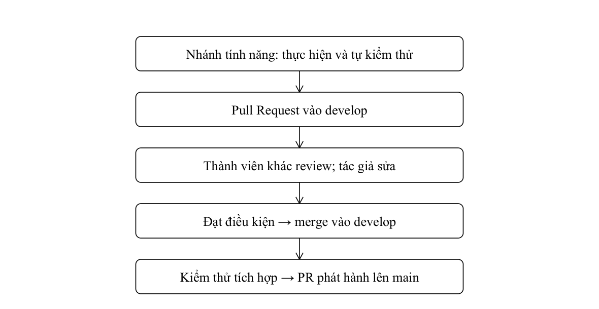
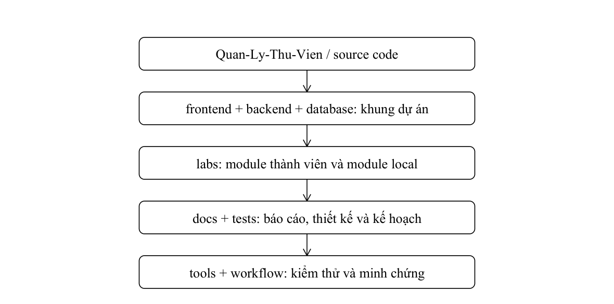
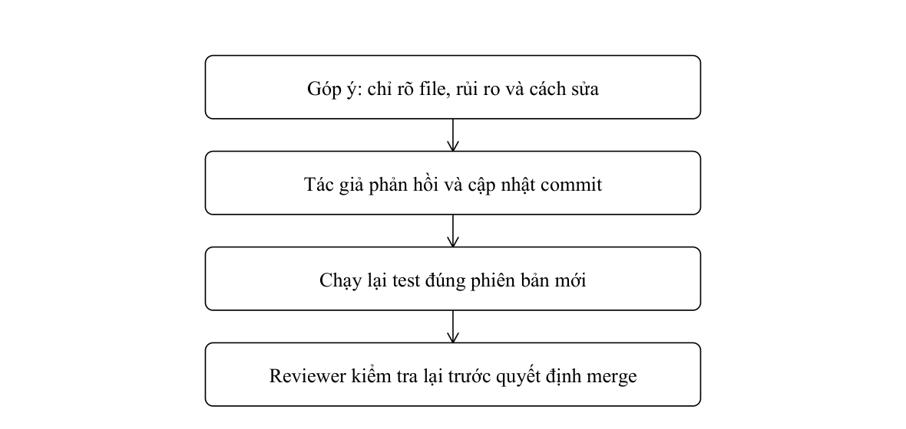

# Tổng quan dự án và cộng tác GitHub

Nội dung Chương 1–2 của báo cáo đã sửa theo mẫu trường. Nội dung thực hành module Lab 8 chuyển sang Phụ lục A.

## CHƯƠNG 1. TỔNG QUAN VỀ DỰ ÁN VÀ QUY TRÌNH PHÁT TRIỂN PHẦN MỀM

### 1.1. Giới thiệu dự án

Tên dự án: Hệ thống quản lý thư viện điện tử. Lớp: N2.1. Đề tài phục vụ học phần thực hành Công nghệ phần mềm và tập trung vào nghiệp vụ thư viện đại học, bao gồm sách giấy và sách điện tử.

Theo báo cáo Lab 6, nhóm gồm Đào Tuấn Minh (52400289), Tăng Hoàng Phúc (52400307), Phạm Minh Huy (52300203) và Lương Văn Chí Tường (52300165). Tài liệu giai đoạn đầu liệt kê ba thành viên; báo cáo tổng hợp sử dụng danh sách bốn thành viên tại Lab 6.

| Nhóm nghiệp vụ | Nội dung |
| --- | --- |
| Tài khoản | Một tài khoản có một vai trò chính; quản lý được phân quyền và khóa tài khoản |
| Sách | Đầu sách và bản sách có định danh riêng; bản đang mượn không được xóa |
| Mượn trả | Tạo yêu cầu, thủ thư duyệt, xác nhận giao mới lập phiếu |
| Gia hạn | Tối đa hai lần, mỗi lần tối đa bảy ngày theo quy tắc chi tiết |

| Nhóm nghiệp vụ | Nội dung |
| --- | --- |
| Tiền phạt | 2.000 đồng × số ngày quá hạn × số cuốn; thủ thư xác nhận |
| Sách điện tử | Tài liệu công khai đọc ngay; tài liệu giới hạn cần quyền đọc |
| Quản lý kho | Chỉ bản khả dụng tính vào số lượng có thể mượn |
| Thông báo | Kết quả duyệt, gia hạn và nhắc hạn trả |

### 1.2. Mục tiêu hệ thống

| Mục tiêu | Tiêu chí đánh giá dự kiến |
| --- | --- |
| Dữ liệu nhất quán | Giao sách tạo phiếu và cập nhật bản sách trong cùng giao dịch |
| Đúng hạn mức | Không quá 3 cuốn/lần và 7 cuốn đang mượn theo BR07 |
| Trả từng phần | Theo dõi ngày trả theo từng dòng, không đóng phiếu sớm |
| Đúng quyền | Độc giả chỉ xem hồ sơ, lịch sử và quyền đọc của chính mình |
| Dễ bảo trì | Controller, Service và Repository tách trách nhiệm |

Các tiêu chí trên là mục tiêu thiết kế và kiểm thử. Chúng chưa được coi là kết quả đo lường của phần mềm nếu thiếu môi trường chạy và log kiểm thử.

Về kỹ thuật, hệ thống được thiết kế theo ba tầng: giao diện HTML/CSS/JavaScript, xử lý nghiệp vụ PHP và truy xuất MySQL qua PDO. Phân tầng giúp kiểm tra nghiệp vụ độc lập với giao diện, đồng thời kiểm soát truy vấn và giao dịch dữ liệu tại một nơi.

### 1.3. Các đối tượng sử dụng hệ thống

| Tác nhân | Trách nhiệm |
| --- | --- |
| Độc giả | Tra cứu, đăng ký mượn, gia hạn, xem hạn trả, tiền phạt và đọc ebook |
| Thủ thư | Duyệt yêu cầu, giao sách, nhận trả, xét gia hạn và xác nhận phạt |
| Nhân viên thư viện | Quản lý danh mục, vị trí, tình trạng, kiểm kê và tài nguyên số |
| Quản lý thư viện | Tài khoản, phân quyền, nhân viên, báo cáo và giám sát |
| Hệ thống mail | Kênh gửi thông báo; cần cấu hình và kiểm thử tích hợp |
| Cổng thanh toán | Tác nhân mở rộng; chưa thay thế quy tắc thu toàn bộ tại quầy |

Các tác nhân có quyền khác nhau. Độc giả chỉ thao tác hồ sơ và khoản mượn của mình; thủ thư duyệt, giao và nhận sách; nhân viên cập nhật kho; quản lý cấp quyền và theo dõi hoạt động. Kiểm tra quyền tại máy chủ giúp bảo vệ dữ liệu ngay cả khi yêu cầu được gửi ngoài giao diện.

### 1.4. Lựa chọn mô hình phát triển phần mềm

### 1.4.1. Mô hình Waterfall

Waterfall chia quá trình phát triển thành các giai đoạn tương đối tuần tự: khảo sát, phân tích, thiết kế, lập trình, kiểm thử và bảo trì. Đầu ra của giai đoạn trước là căn cứ cho giai đoạn sau. Với hệ thống thư viện, tài liệu yêu cầu xác định tác nhân và quy tắc trước khi xây dựng schema, giao diện và mã xử lý.

Ưu điểm là tiến trình dễ theo dõi, trách nhiệm và tài liệu bàn giao rõ ràng. Hạn chế là thay đổi muộn về hạn mức, gia hạn hoặc thời điểm tạo phiếu có thể ảnh hưởng đồng thời tới nhiều phần đã thiết kế. Mô hình phù hợp hơn khi phạm vi nghiệp vụ đã ổn định.

### 1.4.2. Mô hình Agile/Scrum

Agile tiếp cận phát triển theo vòng lặp và phản hồi. Scrum tổ chức công việc thành Sprint, chọn các hạng mục ưu tiên từ Product Backlog và xem lại kết quả sau mỗi đợt. Với đề tài, nhóm có thể hoàn thiện danh mục và mượn trả trước, sau đó bổ sung ebook, thông báo và báo cáo.

| Thành phần | Áp dụng trong đề tài |
| --- | --- |
| Product Backlog | Yêu cầu về tài khoản, sách, mượn trả, phạt và ebook |
| Sprint Planning | Chọn mục tiêu, ước lượng và phân công |
| Scrum Team | Phối hợp phân tích, thiết kế, lập trình và kiểm tra |

| Thành phần | Ý nghĩa |
| --- | --- |
| Sprint Review | Đối chiếu sản phẩm với mục tiêu và tiếp nhận phản hồi |
| Retrospective | Rút kinh nghiệm phối hợp và xử lý trở ngại |
| Increment | Phần kết quả đáp ứng tiêu chí hoàn thành đã thống nhất |

### 1.4.3. So sánh Waterfall và Agile/Scrum

| Tiêu chí | Waterfall | Agile/Scrum |
| --- | --- | --- |
| Triển khai | Tuần tự theo giai đoạn | Lặp theo Sprint |
| Thay đổi yêu cầu | Có thể ảnh hưởng nhiều tài liệu | Ưu tiên lại Backlog |
| Phản hồi | Theo mốc bàn giao lớn | Qua từng đợt Review |
| Rủi ro | Có thể phát hiện muộn | Kiểm chứng từng phần sớm |
| Tiến độ | Theo giai đoạn | Theo hạng mục và Sprint |
| Phù hợp đề tài | Khi quy tắc đã ổn định | Khi cần làm rõ nghiệp vụ dần |

### 1.4.4. Lý do nhóm lựa chọn Agile/Scrum

Các nhóm chức năng thư viện có thể chia thành phần việc tương đối độc lập nhưng có giao điểm dữ liệu: tài khoản, danh mục, yêu cầu mượn, bàn giao, nhận trả, phạt và ebook. Cách làm lặp giúp kiểm chứng các giao điểm này sớm, thay vì đợi toàn bộ phần mềm hoàn tất.

### Áp dụng vào phạm vi đề tài

Bộ tài liệu hiện có cho thấy nghiệp vụ được bổ sung qua nhiều tuần: từ danh mục và mượn trả đến yêu cầu phê duyệt, quyền đọc ebook và giao diện cá nhân. Cách thực hiện theo đợt giúp nhóm điều chỉnh thiết kế mà vẫn duy trì các nghiệp vụ lõi.

Điểm ưu tiên là làm rõ hạn mức, trạng thái và thời điểm ghi nhận giao dịch trước khi phát triển đồng loạt. Các rủi ro như giao trùng bản sách, đóng phiếu khi chưa trả hết và ghi trùng tiền phạt cần được đưa vào tiêu chí chấp nhận.

### 1.5. Tổ chức nhóm dự án

| Thành viên | MSSV | Căn cứ phân công |
| --- | --- | --- |
| Đào Tuấn Minh | 52400289 | Tổng hợp, yêu cầu và đối chiếu nghiệp vụ |
| Tăng Hoàng Phúc | 52400307 | Thiết kế dữ liệu và xử lý nghiệp vụ |
| Phạm Minh Huy | 52300203 | Kiến trúc, giao diện và mô hình hóa |
| Lương Văn Chí Tường | 52300165 | Tham gia thiết kế kiến trúc ở Lab 6 |

Việc dùng Scrum ở đây là định hướng tổ chức. Phân công chức danh Product Owner hoặc Scrum Master cần do nhóm xác nhận; báo cáo không tự gán các vai trò của nhóm trong bản mẫu cho thành viên thư viện. Vai trò và phần việc có căn cứ được lấy từ điều lệ và Lab 6 [2], [5].

| Thành viên | Phần việc ghi trong Lab 6 |
| --- | --- |
| Đào Tuấn Minh | Chương 1, 4, 5 của báo cáo Lab 6 |
| Tăng Hoàng Phúc | Chương 3 của báo cáo Lab 6 |
| Phạm Minh Huy | Chương 2 của báo cáo Lab 6 |
| Lương Văn Chí Tường | Chương 2 của báo cáo Lab 6 |

Bảng trên phản ánh tài liệu phân công, không thay thế lịch sử commit hay kết quả đánh giá đóng góp. Khi làm việc trên repository, mỗi phần cần có người thực hiện, người review và liên kết đến thay đổi cụ thể.

### 1.6. Kế hoạch và tiến độ dự án

### 1.6.1. Các giai đoạn thực hiện

| Giai đoạn | Đầu ra |
| --- | --- |
| Khảo sát | Biểu mẫu, đối tượng sử dụng và phạm vi |
| Phân tích | FR/NFR, Business Rules và Use Case |
| Thiết kế | UML, kiến trúc ba tầng, dữ liệu, giao diện |
| Hiện thực và kiểm thử | Module, Test Case, log và xử lý lỗi |
| Tổng hợp | Báo cáo và đối chiếu minh chứng |

Điều kiện hoàn thành một hạng mục gồm nội dung được rà soát, tên và mã nghiệp vụ thống nhất, Test Case tương ứng đã chuẩn bị; đối với mã nguồn, phải có kết quả kiểm thử và review. Nhóm trưởng tổng hợp thay đổi, thành viên kiểm tra chéo thay vì chỉ ghép các phần tài liệu độc lập.

### 1.6.2. Tiến độ qua các bài thực hành

| Mốc | Tài liệu hoặc đầu ra |
| --- | --- |
| Tuần 1 | Điều lệ, biểu mẫu độc giả/sách/nhân viên/mượn/phạt |
| Tuần 2 | Phân tích yêu cầu và mô hình hóa Use Case |
| Mô hình hóa UML | Danh sách 45 UC và sơ đồ, đặc tả chi tiết |
| Lab 6 | Kiến trúc, dữ liệu, giao diện và đánh giá thiết kế |
| Kiểm thử | Kế hoạch cần thực thi trên phiên bản hệ thống |
| Tổng hợp | Rà soát quy tắc, mã UC và các điểm còn khác nhau |

Các tài liệu được cung cấp đủ để tổng hợp phân tích và thiết kế. Chưa có bộ mã nguồn PHP/MySQL cùng log triển khai trong hồ sơ này, vì vậy chưa xác nhận tiến độ hoàn thành các chức năng bằng số phần trăm hoặc trạng thái đã chạy.

Tài liệu từ điều lệ, Lab 2, UML, các bộ đặc tả UC và Lab 6 là căn cứ đánh giá tiến độ phân tích/thiết kế. Lab 8 đã có hai module xác thực và kết quả kiểm thử; review, sửa theo góp ý và merge còn cần nhóm hoàn thành. Không đồng nhất phần thiết kế thư viện với chức năng đã triển khai.

### Ví dụ ưu tiên Product Backlog từ điều lệ

| User Story | Ưu tiên | Story Point |
| --- | --- | --- |
| US03 – Tìm kiếm sách | High | 3 |
| US06 – Mượn theo yêu cầu | High | 5 |
| US14 – Duyệt yêu cầu mượn/trả | High | 5 |
| US15 – Ghi nhận trả sách | High | 5 |
| US09 – Gửi yêu cầu gia hạn | Medium | 3 |
| US26 – Xuất Excel | Low | 5 |

Điểm là ước lượng trong điều lệ [2], không phải số giờ hoặc kết quả thực hiện. Backlog cần được rà soát lại theo bộ quy tắc và danh mục UC đã thống nhất.

Mốc Lab 8: API đăng ký/đăng nhập bằng Node.js, Express, bcrypt; kiểm thử Jest/Supertest; minh chứng local 20 test và PR 19 test. Mốc tiếp theo là peer review thật, phản hồi góp ý và tích hợp có kiểm soát. Các nghiệp vụ mượn/trả, gia hạn, phạt và ebook vẫn ở phạm vi thiết kế.

## CHƯƠNG 2. QUẢN LÝ DỰ ÁN VÀ CỘNG TÁC PHÁT TRIỂN THEO GITHUB

### 2.1. Mục tiêu và công cụ quản lý mã nguồn

Git được dùng để lưu lịch sử thay đổi, tách phần việc theo nhánh và đối chiếu đóng góp. GitHub lưu mã nguồn, tài liệu và các minh chứng kiểm thử; Pull Request tạo điểm kiểm tra trước khi tích hợp. Với hệ thống thư viện, thay đổi một quy tắc mượn hoặc cấu trúc dữ liệu phải được phản ánh đồng thời trong yêu cầu, thiết kế và kế hoạch kiểm thử.

| Công cụ hoặc khái niệm | Vai trò trong dự án |
| --- | --- |
| Git | Theo dõi thay đổi, commit, nhánh và lịch sử của nhóm |
| GitHub Repository | Lưu mã nguồn, tài liệu và báo cáo thư viện |
| Branch | Tách phần bổ sung khỏi main/develop và khỏi mã của thành viên khác |
| Commit | Ghi một thay đổi có mục tiêu, có thể so sánh với phiên bản trước |
| Pull Request | Đề nghị tích hợp và nơi thực hiện peer review |
| Code Review | Kiểm tra logic, chuẩn mã, lỗi, bảo mật và kết quả test |
| README | Hướng dẫn chạy đúng hai module Lab 8 và phân biệt phần thiết kế |

Repository của nhóm: https://github.com/DaoTuanMinh-core/Quan-Ly-Thu-Vien. Hai module Lab 8 nằm ngoài bộ khung PHP/MySQL; việc chạy được API Node.js không đồng nghĩa hệ thống thư viện đã tích hợp đầy đủ.

### Repository và README của nhóm

Nhánh bổ sung hiện tại là feature/lab08-report-alignment. Nội dung được đối chiếu ngày 30/10/2026; main và develop vẫn ở commit 7f6f5d5, nhánh module của thành viên ở a035441, nhánh bổ sung ở d912114. Tên nhánh và commit giúp xác định đúng phiên bản thay vì chỉ dẫn tới trang mặc định của repository.

| Nội dung | Đường dẫn hoặc bằng chứng |
| --- | --- |
| Repository | https://github.com/DaoTuanMinh-core/Quan-Ly-Thu-Vien |
| README bản bổ sung | https://github.com/DaoTuanMinh-core/Quan-Ly-Thu-Vien/blob/feature/lab08-report-alignment/README.md |
| Mã của thành viên | labs/lab08-auth; 19 test; giữ nguyên nội dung tại a035441 |
| Bản local trong báo cáo | labs/lab08-auth-local; 20 test; Map, AppError và factory |
| Tài liệu | docs/requirements, docs/design, docs/reports, docs/evidence |

README mới bổ sung hướng dẫn ở đầu và giữ toàn bộ README gốc của nhóm phía sau. Công cụ verify:preservation đã kiểm tra 32 file gốc; khác biệt kết thúc dòng LF/CRLF không làm thay đổi logic mã. Các phần của thành viên không bị ghi đè bởi bản local.

Ảnh chụp repository và README có thể được chèn làm minh chứng trực quan sau khi mở đúng nhánh trên. Các liên kết và bảng trạng thái ở đây là căn cứ đối chiếu; không sử dụng ảnh repository khách sạn trong file mẫu làm bằng chứng cho đề tài thư viện.

### 2.2. Mô hình nhánh Git Flow

Nhóm áp dụng Git Flow rút gọn theo định hướng của mẫu: main lưu phiên bản ổn định; develop là nhánh tích hợp; nhánh tính năng chứa thay đổi riêng. Bản bổ sung được tạo từ nhánh module đã có để giữ lịch sử của tác giả. Chỉ push lên nhánh riêng, chưa merge vào main hoặc develop.

| Nhánh | Vai trò và trạng thái |
| --- | --- |
| main | Nhánh mặc định; chưa nhận phần bổ sung |
| develop | Nhánh đích của PR #1; chưa nhận phần bổ sung |
| feature/auth-module | Module Lab 8 do huy-203-stu-tdtu đưa lên PR #1 |
| feature/lab08-report-alignment | Bổ sung bản local, tài liệu và báo cáo; giữ nguyên module thành viên |
| backend, database, docs, frontend, tests | Các nhánh khung đã có trong repository; tên nhánh không chứng minh chức năng đã hoàn thành |

Quy trình Git Flow rút gọn của dự án thư viện

Khi bắt đầu công việc, thành viên kiểm tra thay đổi chưa commit, cập nhật nhánh nền và tạo nhánh theo phạm vi. Mỗi commit tập trung một mục tiêu; trước khi push phải đọc diff và chạy kiểm thử phù hợp. Không đưa node_modules, cấu hình chứa mật khẩu hoặc dữ liệu độc giả thật vào repository.

Push chỉ cập nhật một nhánh từ xa. PR là đề nghị tích hợp; review là hoạt động kiểm tra; merge mới đưa thay đổi vào nhánh đích. Báo cáo chỉ ghi “đã merge” khi GitHub xác nhận trạng thái đó. Những file giao diện từng bị xóa bởi commit của nhóm vẫn được giữ nguyên trạng thái xóa, không tự phục hồi vào mã đang chạy.

### 2.3. Cấu trúc Skeleton Code và tài liệu

| Thành phần | Vai trò và mức độ hiện thực |
| --- | --- |
| frontend/ | Bộ khung giao diện PHP/MySQL; chưa phải giao diện thư viện hoàn chỉnh |
| backend/ | Khung config, routes, middleware, controllers, services và models |
| database/ | Hướng dẫn migrations/seeds; chưa có database nghiệp vụ đã chạy |
| labs/lab08-auth/ | API xác thực của thành viên và 19 test |
| labs/lab08-auth-local/ | API xác thực local và 20 test khớp số liệu báo cáo |
| docs/ | Yêu cầu, UML, thiết kế, báo cáo và minh chứng |
| tests/test-plan.md | TC-LIB01–20 dự kiến, chưa thực thi |
| tools/ và .github/workflows/ | Lệnh kiểm thử, kiểm tra bảo toàn và workflow Lab 8 |

Bộ khung PHP/MySQL và hai module Lab 8 có phạm vi khác nhau. Controller–Service–Repository là định hướng kiến trúc của hệ thống thư viện; module xác thực đang dùng dữ liệu RAM. Không suy ra đã có MySQL, phiên đăng nhập hoặc phân quyền chỉ vì đã có thư mục và ERD.

Cấu trúc repository thư viện theo phạm vi hiện có

### 2.4. Commit, Pull Request và Code Review

Quy trình gồm: (1) tạo nhánh; (2) thay đổi mã hoặc tài liệu; (3) xem diff và kiểm thử; (4) commit với mô tả rõ; (5) push và mở PR; (6) thành viên khác review; (7) tác giả xử lý góp ý, chạy lại test và nhóm quyết định merge. Đối với Lab 8, mỗi thành viên cần ít nhất ba góp ý cụ thể theo yêu cầu bài thực hành; gợi ý trong tài liệu không thay thế nhận xét thật trên PR.

### Đối chiếu commit và Pull Request

| Bằng chứng | Nội dung đã xác minh |
| --- | --- |
| a035441 | Commit module auth của huy-203-stu-tdtu theo tác giả Git/PR; mã nguồn gốc được giữ riêng |
| d912114 | Commit bổ sung tài liệu, bản local, hướng dẫn chạy và minh chứng; không sửa module gốc |
| PR #1 | feature/auth-module → develop; trạng thái Open, merged=false |
| Peer review | Snapshot kiểm tra trước đó chưa có review/nhận xét; chưa ghi nhận nhóm đã hoàn thành peer review |
| Workflow nhánh bổ sung | Lab 8 tests: completed / success; kết quả kiểm tra ngày 30/10/2026 |

PR #1: https://github.com/DaoTuanMinh-core/Quan-Ly-Thu-Vien/pull/1. Kết quả workflow: https://github.com/DaoTuanMinh-core/Quan-Ly-Thu-Vien/actions/runs/41011965803. Kiểm thử tự động thành công là bằng chứng chạy mã, không thay thế người review và không tự xác nhận đã merge.

Chu trình xử lý góp ý trong Pull Request

### 2.5. Phân công công việc và phối hợp

Phân công dưới đây dựa vào phần việc ghi trong tài liệu Lab 6 và bằng chứng mã nguồn đã có. Không chuyển vai trò của nhóm khách sạn sang nhóm thư viện hoặc tự gán Product Owner/Scrum Master khi chưa có căn cứ.

| Thành viên | Căn cứ phần việc và cách phối hợp |
| --- | --- |
| Đào Tuấn Minh – 52400289 | Chương 1, 4, 5 của Lab 6; tổng hợp yêu cầu và đối chiếu báo cáo |
| Tăng Hoàng Phúc – 52400307 | Chương 3 của Lab 6; phối hợp thiết kế dữ liệu và kiểm tra ràng buộc |
| Phạm Minh Huy – 52300203 | Chương 2 của Lab 6; tài khoản huy-203-stu-tdtu thực hiện module PR #1 |
| Lương Văn Chí Tường – 52300165 | Tham gia Chương 2 của Lab 6; phối hợp mô hình và kiến trúc |

Khi thay đổi nghiệp vụ, người tổng hợp kiểm tra BR/UC; người phụ trách thiết kế rà soát dữ liệu và sơ đồ; người viết mã bổ sung test; thành viên khác kiểm tra chéo. Bảng phân công tài liệu không được dùng thay thống kê commit hoặc kết quả đánh giá đóng góp cá nhân.

### 2.6. Kết quả, giới hạn và bài học

Kết quả hiện có gồm repository, nhánh tính năng, PR #1, hai module xác thực chạy độc lập, tài liệu thiết kế và workflow kiểm thử thành công. Bản local đạt 20/20 test; module thành viên đạt 19/19 test. Chi tiết coverage ở Chương 6 và phụ lục đối chiếu.

| Khía cạnh | Kết quả hoặc giới hạn |
| --- | --- |
| Quản lý phiên bản | Có repository, nhánh và commit; nội dung gốc được bảo toàn |
| Tích hợp | PR #1 còn mở; phần bổ sung chưa merge vào main/develop |
| Kiểm tra mã | Có test/coverage và workflow thành công; peer review thật còn cần hoàn thành |
| Sản phẩm phần mềm | API đăng ký/đăng nhập Lab 8; chưa triển khai toàn bộ nghiệp vụ thư viện |
| Tài liệu | Có BR/FR/UC, UML, mô hình dữ liệu và kế hoạch kiểm thử |
| Ảnh minh chứng | Nhóm chụp đúng nhánh, commit và kết quả chạy; không dùng hình minh họa làm kết quả thật |

Các khó khăn đã gặp gồm tài khoản Git không có quyền ghi, nhầm tên nhánh và khác biệt giữa bản local với mã trên PR. Cách xử lý là xác định tài khoản đúng quyền, dùng nhánh riêng, kiểm tra commit và giữ bộ kết quả cho từng phiên bản. Đổi tên nhánh không làm đổi lịch sử commit; đổi tên tác giả Git không thay tài khoản xác thực GitHub.

Bài học là quản lý tài liệu cùng mã nguồn và kiểm chứng trạng thái trước khi báo cáo. Khi sửa hạn mức hoặc thời điểm tạo phiếu, nhóm cần cập nhật quy tắc, đặc tả, sơ đồ và test trong cùng đợt. Phần coding standards, xử lý ngoại lệ và bảo mật của Lab 8 được giữ tại Phụ lục A; các kết quả thực chạy và review tiếp tục ở Chương 6–7.

