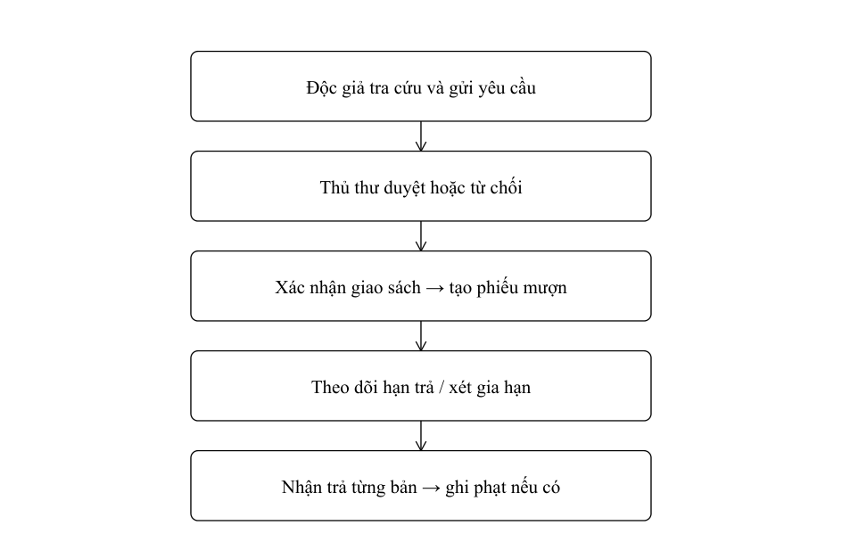
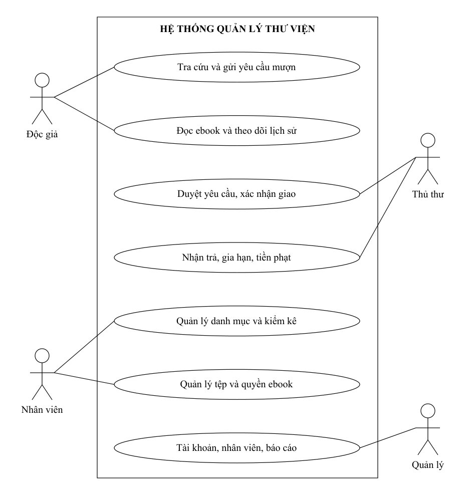

# Yêu cầu thư viện và truy vết theo báo cáo

Nguồn: báo cáo Word hoàn thiện 71 trang, Chương 3. Các quy tắc đã xác nhận khác với giả định TK01–TK04; chưa có hiện thực các nghiệp vụ này trong backend PHP.

# CHƯƠNG 3. PHÂN TÍCH VÀ ĐẶC TẢ YÊU CẦU HỆ THỐNG

## 3.1. Khảo sát nghiệp vụ và bài toán

Quy trình trung tâm bắt đầu từ độc giả tra cứu sách và gửi đăng ký mượn. Hệ thống kiểm tra điều kiện, lưu yêu cầu chờ duyệt và cho thủ thư xử lý. Chỉ khi xác nhận bàn giao bản sách, hệ thống lập phiếu mượn và bắt đầu theo dõi hạn trả.

Khi nhận trả, thủ thư đối chiếu bản sách với phiếu, kiểm tra tình trạng và ngày trả. Hệ thống cập nhật từng dòng mượn, tính khoản phạt theo quy định và giữ phiếu đang mở nếu còn sách chưa trả. Sách hư hỏng hoặc mất không được cộng vào số lượng khả dụng.

| Nghiệp vụ | Vấn đề cần kiểm soát |
| --- | --- |
| Mượn | Hạn mức, quyền, khả dụng và tranh chấp bản sách |
| Gia hạn | Số lần, số ngày, thời điểm yêu cầu và phê duyệt |
| Trả | Đúng bản, chống xác nhận lặp, hỗ trợ từng phần |
| Phạt | Nguồn vi phạm, công thức, xác nhận và thu tiền |
| Ebook | Tài liệu công khai/giới hạn, thời hạn quyền và thu hồi |

Mỗi bản sách cần được phân biệt với đầu sách. Một đầu sách có thể còn bản khả dụng dù một số bản đang mượn hoặc hỏng. Dữ liệu sách, người mượn, phiếu và khoản phạt phải liên kết để thủ thư đối chiếu, thay vì chỉ thay đổi một số lượng tổng không truy được nguyên nhân.

*Hình 3.1. Quy trình nghiệp vụ tổng quát*

## 3.2. Phạm vi hệ thống và các tác nhân

Hệ thống bao gồm cổng độc giả và khu vực nghiệp vụ dành cho nhân viên. Các quyền đọc/ghi phải gắn với vai trò và đối tượng dữ liệu. Sách điện tử giới hạn được cấp quyền theo yêu cầu đã duyệt, sau đó thu hồi khi hết hạn.

Hệ thống mail và cổng thanh toán nằm ngoài ranh giới ứng dụng. Thanh toán trực tuyến là hướng tích hợp; quy trình cơ sở hiện dùng thu toàn bộ tại quầy theo BR19.

| Tác nhân | Tương tác chính |
| --- | --- |
| Độc giả | UC-TV01, 02, 08–20: tra cứu, mượn, gia hạn, lịch sử, ebook |
| Thủ thư | UC-TV01, 06–07, 21–31: kho, giao nhận, gia hạn, phạt và duyệt |
| Nhân viên thư viện | UC-TV01, 03, 06, 32–41: danh mục, kho, độc giả và tài nguyên số |
| Quản lý thư viện | UC-TV01, 03–05, 42–45: thêm sách, báo cáo, tài khoản và nhân viên |
| Hệ thống mail | Gửi thông báo; cần xác định cấu hình và tình huống lỗi |
| Hệ thống thanh toán | Mở rộng, chưa xác nhận triển khai thực tế |

UC-TV03 mô tả tra cứu theo tên, mã, tác giả và thể loại; UC-TV08 hỗ trợ tìm kiếm cho người dùng. Khi xây dựng API dùng chung, cần giữ nguyên phạm vi quyền của từng tác nhân thay vì suy ra rằng mọi thao tác quản lý đều được mở cho độc giả.

Quản lý thư viện có thể cấp và vô hiệu hóa tài khoản theo BR02–03. Việc xem dữ liệu kho không mặc nhiên cho phép sửa dữ liệu kho; tương tự, quyền đọc lịch sử không bao gồm quyền xác nhận giao hay nhận trả. Đặc tả UC-TV03 dành cho nhân viên/quản lý, còn UC-TV08 phục vụ tra cứu cho người dùng, có thể công khai theo chính sách.

*Hình 3.2. Phân nhóm Use Case tổng quát*

Sơ đồ tổng hợp các nhóm chức năng theo bộ đặc tả 45 Use Case. Các quan hệ chi tiết và điều kiện được diễn giải trong phần đặc tả; nhóm chức năng không đồng nghĩa với quyền truy cập mọi dữ liệu trong nhóm.

Các nhóm Use Case được tổng hợp để sơ đồ dễ đọc; danh mục đầy đủ và actor của từng mã nằm tại mục 3.6. Hệ thống mail là tác nhân hỗ trợ thông báo; cổng thanh toán chỉ thuộc hướng mở rộng theo phạm vi đã nêu.

## 3.3. Quy tắc nghiệp vụ

| Mã | Nội dung theo tài liệu nghiệp vụ [6] |
| --- | --- |
| BR01 | Mỗi sinh viên một tài khoản; nguồn nêu email và mã sinh viên làm thông tin định danh. |
| BR02 | Bốn vai trò chính; mỗi tài khoản một vai trò; quản lý được phân quyền. |
| BR03 | Quản lý thư viện có quyền khóa hoặc vô hiệu hóa tài khoản. |
| BR04 | Mỗi đầu sách có mã riêng; mỗi bản sách có mã duy nhất. |
| BR05 | Trạng thái bản sách: khả dụng, đang mượn, hư hỏng, mất. |
| BR06 | Không xóa/ngừng lưu hành bản sách đang được mượn. |
| BR07 | Tối đa 3 cuốn/lần và 7 cuốn đang mượn; dùng bộ quy tắc đã xác nhận. |
| BR08 | Hạn mượn tối đa 14 ngày kể từ khi lập phiếu. |
| BR09 | Tài khoản hợp lệ; kiểm tra hạn mức mỗi lần và tổng đang mượn. |
| BR10 | Gửi yêu cầu → thủ thư duyệt → xác nhận giao → tạo phiếu mượn. |
| BR11 | Thủ thư kiểm tra đúng sách theo phiếu và xác nhận đã nhận trả. |
| BR12 | Được trả từng cuốn; cuốn chưa trả đúng hạn vẫn phát sinh phạt. |
| BR13 | Được gia hạn tối đa 2 lần. |
| BR14 | Mỗi lần gia hạn thêm tối đa 7 ngày. |
| BR15 | Được xét khi trễ không quá 1 ngày, chưa vượt 2 lần và được thủ thư duyệt. |
| BR16 | Phạt quá hạn = 2.000 đồng × số ngày trễ × số cuốn. |
| BR17 | Mất/hỏng do độc giả: bồi thường giá trị sách và phí theo quy định chưa chốt. |
| BR18 | Hệ thống tính khoản phạt; thủ thư kiểm tra và xác nhận ghi nhận. |
| BR19 | Thanh toán toàn bộ tại quầy; không hỗ trợ thanh toán một phần. |
| BR20 | Ebook công khai đọc ngay; loại giới hạn cần đăng ký và được thủ thư duyệt. |
| BR21 | Tối đa 3 ebook/lần; thời hạn quyền mượn 14 ngày. |
| BR22 | Tự thu hồi quyền đọc khi hết thời hạn. |
| BR23 | Chỉ bản khả dụng được tính vào số lượng có thể mượn. |
| BR24 | Mỗi bản sách có vị trí xác định, mã vị trí theo quy tắc thể loại. |
| BR25 | Thông báo khi duyệt mượn, gia hạn hoặc sắp đến hạn trả. |

## 3.4. Yêu cầu chức năng

| Mã | Chức năng | Mô tả |
| --- | --- | --- |
| FR01 | Đăng nhập và phiên | Xác thực, trạng thái tài khoản, tạo phiên đúng quyền |
| FR02 | Tài khoản và nhân viên | Cấp/khóa tài khoản, vai trò, hồ sơ nhân viên |
| FR03 | Hồ sơ độc giả | Tra cứu và quản lý thông tin độc giả theo quyền |
| FR04 | Quản lý đầu sách | Thêm, xem, sửa thông tin sách |
| FR05 | Danh mục và vị trí | Tác giả, thể loại, NXB, kệ và vị trí sách |
| FR06 | Kho và kiểm kê | Khả dụng, tình trạng, số lượng và chênh lệch kho |
| FR07 | Tra cứu và chi tiết | Tìm, lọc, sắp xếp và xem sách |
| FR08 | Đăng ký mượn | Lưu yêu cầu, trả mã và trạng thái |
| FR09 | Duyệt và bàn giao | Duyệt/từ chối, xác nhận giao rồi lập phiếu |
| FR10 | Nhận trả và sự cố | Nhận từng bản, ghi mất hoặc hư hỏng |
| FR11 | Gia hạn | Gửi yêu cầu, thủ thư xét, cập nhật hạn sau duyệt |
| FR12 | Theo dõi khoản mượn | Hạn trả, lịch sử, hoạt động và quá hạn |
| FR13 | Tiền phạt | Tính, ghi nhận, tra cứu và xem khoản phạt |
| FR14 | Thu tiền phạt | Ghi nhận thu toàn bộ tại quầy theo BR19 |
| FR15 | Sách và tệp điện tử | Quản lý metadata, tệp và trạng thái ebook |
| FR16 | Quyền và mượn ebook | Cấp, kiểm tra, thu hồi quyền có thời hạn |
| FR17 | Đọc và tiến độ | Đọc trực tuyến, tiếp tục đọc và lịch sử đọc |
| FR18 | Tủ sách và yêu thích | Quản lý dữ liệu cá nhân gắn với tài khoản |
| FR19 | Thông báo | Lưu, hiển thị và đánh dấu đã đọc |
| FR20 | Báo cáo và thống kê | Tổng hợp dữ liệu thư viện theo bộ lọc |

FR01–FR20 là mã tổng hợp của báo cáo này, gom theo chức năng và ánh xạ tới đầy đủ 45 UC ở mục 3.8. Chúng không giữ nguyên hệ FR khác nhau của tài liệu giai đoạn đầu. Tên UC và actor được đối chiếu với bộ đặc tả chi tiết.

## 3.5. Yêu cầu phi chức năng

| Nhóm | Yêu cầu |
| --- | --- |
| Hiệu năng | Mục tiêu từ điều lệ: tra cứu ≤ 2 giây; mượn/trả ≤ 2,5 giây; ≥ 100 người đồng thời; xuất Excel ≤ 6 giây. Chưa phải số đo đạt được. |
| Bảo mật | Băm mật khẩu, phiên, phân quyền phía máy chủ và quyền trên từng đối tượng. |
| Chính xác | Chống giao trùng bản sách, tính phạt đúng hạn hiệu lực, xử lý trả từng phần. |
| Sử dụng | Nhãn rõ, thông báo lỗi và trạng thái rỗng; hỗ trợ thao tác của từng vai trò. |
| Tin cậy | Transaction, chống xử lý lặp, sao lưu và khôi phục có kiểm chứng. |

## 3.6. Danh sách Use Case

| Mã | Tên Use Case | Actor |
| --- | --- | --- |
| UC-TV01 | Đăng nhập | Tất cả |
| UC-TV02 | Đăng ký mượn sách | ĐG |
| UC-TV03 | Tra cứu sách theo tên, mã sách, tác giả hoặc thể loại | NV, QL |
| UC-TV04 | Thêm sách mới vào hệ thống | QL |
| UC-TV05 | Xem báo cáo và thống kê hoạt động thư viện | QL |
| UC-TV06 | Theo dõi tình trạng và số lượng sách | TT, NV |
| UC-TV07 | Tính và ghi nhận tiền phạt | Thủ thư |
| UC-TV08 | Hỗ trợ sắp xếp và tìm kiếm sách | ĐG |
| UC-TV09 | Xem thời hạn trả sách | ĐG |
| UC-TV10 | Gửi yêu cầu gia hạn sách | ĐG |
| UC-TV11 | Xem các khoản tiền phạt nếu có | ĐG |
| UC-TV12 | Xem lịch sử mượn – trả | ĐG |
| UC-TV13 | Xem thông tin chi tiết sách | ĐG |
| UC-TV14 | Đọc sách điện tử trực tuyến | ĐG |

ĐG: độc giả/người dùng; TT: thủ thư; NV: nhân viên thư viện; QL: quản lý thư viện. Giữ mã UC theo danh mục 45 mục và các bộ đặc tả [4], [7]–[10].

| Mã | Tên Use Case | Actor |
| --- | --- | --- |
| UC-TV15 | Quản lý tủ sách cá nhân | ĐG |
| UC-TV16 | Quản lý sách yêu thích | ĐG |
| UC-TV17 | Tiếp tục đọc sách điện tử | ĐG |
| UC-TV18 | Mượn sách điện tử | ĐG |
| UC-TV19 | Xem lịch sử đọc sách điện tử | ĐG |
| UC-TV20 | Nhận thông báo | ĐG |
| UC-TV21 | Xác nhận trả sách | TT |
| UC-TV22 | Theo dõi hoạt động mượn – trả | TT |
| UC-TV23 | Quản lý tiền phạt | TT |
| UC-TV24 | Lập phiếu mượn sách | TT |
| UC-TV25 | Xử lý gia hạn | TT |
| UC-TV26 | Kiểm tra tình trạng sách | TT |
| UC-TV27 | Ghi nhận sách mất/hư hỏng | TT |
| UC-TV28 | Tính và ghi nhận tiền phạt | TT |
| UC-TV29 | Theo dõi sách quá hạn | TT |
| UC-TV30 | Duyệt yêu cầu mượn sách | TT |
| UC-TV31 | Thanh toán/ghi nhận thanh toán tiền phạt | TT |
| UC-TV32 | Quản lý sách | NV |
| UC-TV33 | Cập nhật thông tin sách | NV |
| UC-TV34 | Quản lý thông tin độc giả | NV |
| UC-TV35 | Cập nhật số lượng và tình trạng sách | NV |
| UC-TV36 | Quản lý vị trí lưu trữ | NV |
| UC-TV37 | Quản lý thể loại, tác giả, NXB | NV |
| UC-TV38 | Kiểm kê sách | NV |
| UC-TV39 | Quản lý sách điện tử | NV |
| UC-TV40 | Quản lý tệp sách điện tử | NV |
| UC-TV41 | Quản lý quyền truy cập sách điện tử | NV |
| UC-TV42 | Xem báo cáo và thống kê | QL |
| UC-TV43 | Theo dõi tình trạng và số lượng sách | QL |
| UC-TV44 | Quản lý tài khoản và phân quyền | QL |
| UC-TV45 | Quản lý thông tin nhân viên | QL |

## 3.7. Đặc tả Use Case tiêu biểu

## 3.7.1. UC-TV02 – Đăng ký mượn sách

| Thuộc tính | Mô tả |
| --- | --- |
| Actor / Trigger | Độc giả; chọn sách và gửi đăng ký. |
| Mục tiêu | Ghi nhận nhu cầu mượn để thủ thư xét duyệt. |
| Tiền điều kiện | Đã đăng nhập; tài khoản hợp lệ; sách thuộc danh mục. |
| Hậu điều kiện | Yêu cầu Chờ duyệt được lưu; chưa có phiếu mượn hoặc ghi nhận đã giao. |
| Luồng chính | 1. Mở danh mục. 2. Chọn sách. 3. Nhập thông tin. 4. Gửi yêu cầu. 5. Kiểm tra tài khoản, hạn mức, khả dụng. 6. Lưu yêu cầu và chi tiết. 7. Trả mã, trạng thái. |
| Ngoại lệ | Thiếu dữ liệu: yêu cầu sửa. Hết sách/vượt hạn mức: từ chối. Yêu cầu trùng: hiển thị trạng thái hiện có. Lỗi lưu: không thông báo thành công. |
| Tham chiếu | FR07, FR08; BR07–10; UC-TV30 xét duyệt. |

## 3.7.2. UC-TV24 – Lập phiếu mượn sách

| Thuộc tính | Mô tả |
| --- | --- |
| Actor / Trigger | Thủ thư; xác nhận giao sách cho yêu cầu đã duyệt. |
| Mục tiêu | Ghi nhận bàn giao thực tế, thời điểm mượn và trách nhiệm trả. |
| Tiền điều kiện | Độc giả tồn tại, đủ điều kiện; đúng yêu cầu đã duyệt; bản sách khả dụng. Hạn trả theo chính sách đã chốt. |
| Hậu điều kiện | Tạo phiếu, dòng mượn; bản sách Đang mượn trong cùng transaction. |

| Thuộc tính | Mô tả UC-TV24 (tiếp) |
| --- | --- |
| Luồng chính | 1. Tra yêu cầu. 2. Xác minh độc giả. 3. Chọn từng bản thực giao. 4. Kiểm tra hạn mức và hạn trả. 5. Xác nhận giao. 6. Khóa/kiểm tra bản, tạo phiếu và cập nhật trong transaction. 7. Trả mã phiếu và hạn trả. |
| Ngoại lệ | Chưa duyệt, bản vừa bị giao hoặc vượt hạn mức: từ chối. Thao tác lặp: không tạo thêm phiếu. Lỗi dữ liệu: rollback. |
| Tham chiếu | FR09; BR07–10. Áp dụng hạn mượn tối đa 14 ngày theo bộ quy tắc xác nhận; không thêm mức tối thiểu từ ví dụ khác. |

## 3.7.3. UC-TV21 – Xác nhận trả sách

| Thuộc tính | Mô tả |
| --- | --- |
| Actor / Trigger | Thủ thư; độc giả mang sách đến quầy. |
| Mục tiêu | Ghi nhận từng bản đã nhận, tình trạng và xử lý vi phạm. |
| Tiền điều kiện | Thủ thư có quyền; dòng mượn chưa trả tồn tại. |
| Hậu điều kiện | Ngày trả được lưu cho dòng đã nhận. Chỉ hoàn tất phiếu khi hết dòng mở; sách hỏng không tự về Khả dụng. |
| Luồng chính | 1. Tra phiếu/bản sách. 2. Đối chiếu thực tế. 3. Kiểm tra hạn và tình trạng. 4. Tính khoản phạt đề nghị. 5. Thủ thư xác nhận. 6. Ghi trả, trạng thái và phạt trong transaction. 7. Thông báo kết quả. |
| Ngoại lệ | Sai bản, đã trả hoặc không có quyền: từ chối. Lỗi ghi: rollback. Trả một phần: giữ các dòng khác đang mở. |
| Tham chiếu | FR10, FR13; BR11–12, BR16–18; UC-TV27/28 xử lý vi phạm. |

## 3.8. Liên kết giữa yêu cầu và Use Case

| Yêu cầu | Use Case UC-TV |
| --- | --- |
| FR01 – Đăng nhập và phiên | 01 |
| FR02 – Tài khoản và nhân viên | 44, 45 |
| FR03 – Hồ sơ độc giả | 34 |
| FR04 – Quản lý đầu sách | 04, 32, 33 |
| FR05 – Danh mục và vị trí | 36, 37 |
| FR06 – Kho và kiểm kê | 06, 26, 35, 38, 43 |
| FR07 – Tra cứu và chi tiết | 03, 08, 13 |
| FR08 – Đăng ký mượn | 02 |
| FR09 – Duyệt và bàn giao | 24, 30 |
| FR10 – Nhận trả và sự cố | 21, 27 |
| FR11 – Gia hạn | 10, 25 |
| FR12 – Theo dõi khoản mượn | 09, 12, 22, 29 |
| FR13 – Tiền phạt | 07, 11, 23, 28 |
| FR14 – Thu tiền phạt | 31 |
| FR15 – Sách và tệp điện tử | 39, 40 |
| FR16 – Quyền và mượn ebook | 18, 41 |
| FR17 – Đọc và tiến độ | 14, 17, 19 |
| FR18 – Tủ sách và yêu thích | 15, 16 |
| FR19 – Thông báo | 20 |
| FR20 – Báo cáo và thống kê | 05, 42 |

Danh mục giữ cả các mã gần nghĩa: UC-TV07/28 tính phạt, UC-TV05/42 báo cáo, UC-TV06/43 theo dõi kho. Các chức năng có thể dùng chung Service nhưng giữ riêng điểm truy vết và tác nhân. Tập mã trong bảng bao phủ UC-TV01 đến UC-TV45.

## 3.9. Truy vết yêu cầu đến thiết kế và kiểm thử

UC ghi bằng số, cùng tiền tố UC-TV. BR là quy tắc liên quan, không suy ra các quy tắc ngoài phạm vi. TC-LIB là kế hoạch chưa chạy ở mục 6.3; 20 test xác thực local được báo cáo riêng ở mục 6.1.

| FR / BR | UC | Mục thiết kế | Dữ liệu | Kiểm thử / trạng thái |
| --- | --- | --- | --- | --- |
| FR01 / BR01–03 | 01 | 2.1; 5.4.7 | TaiKhoan | TC-LIB01; một phần local |
| FR02 / BR01–03 | 44, 45 | 3.10; 5.4.7 | TaiKhoan, NhanVien | TC-LIB02; thiết kế |
| FR03 / BR01–03 | 34 | 3.10; 5.4.7 | Doc_gia | TC-LIB03; thiết kế |
| FR04 / BR04–06 | 04, 32, 33 | 4.1; 5.4.4 | Sach | TC-LIB04; thiết kế |
| FR05 / BR04,24 | 36, 37 | 4.1; 5.4.4 | Tac_gia, The_loai, NXB, Vi_tri | TC-LIB05; thiết kế |
| FR06 / BR05–06,23 | 06, 26, 35, 38, 43 | 4.3; 5.4.7 | BanSach, KiemKe | TC-LIB06; thiết kế |
| FR07 / BR04,23 | 03, 08, 13 | 4.1; 5.4.4 | Sach, BanSach | TC-LIB07; thiết kế |

## 3.9. Truy vết yêu cầu đến thiết kế và kiểm thử (tiếp)

UC ghi bằng số, cùng tiền tố UC-TV. BR là quy tắc liên quan, không suy ra các quy tắc ngoài phạm vi. TC-LIB là kế hoạch chưa chạy ở mục 6.3; 20 test xác thực local được báo cáo riêng ở mục 6.1.

| FR / BR | UC | Mục thiết kế | Dữ liệu | Kiểm thử / trạng thái |
| --- | --- | --- | --- | --- |
| FR08 / BR07–10 | 02 | 4.2.1; 5.3.1 | YeuCauMuon, CTYeuCau | TC-LIB08; thiết kế |
| FR09 / BR07–10,23 | 24, 30 | 4.2.2; 5.3.2 | Phieu_muon, CTMuon, BanSach | TC-LIB09; thiết kế |
| FR10 / BR05,11–12,17–18 | 21, 27 | 4.2.4; 5.3.3 | CTMuon, BanSach, CTPhat | TC-LIB10; thiết kế |
| FR11 / BR13–15 | 10, 25 | 4.2.3; 5.4.8 | GiaHan, CTMuon | TC-LIB11; thiết kế |
| FR12 / BR08,12 | 09, 12, 22, 29 | 4.3; 5.4.8 | Phieu_muon, CTMuon | TC-LIB12; thiết kế |
| FR13 / BR16–18 | 07, 11, 23, 28 | 4.2.4; 5.4.8 | Phieu_phat, CTPhat | TC-LIB13; thiết kế |
| FR14 / BR19 | 31 | 4.3; 5.4.8 | ThanhToanPhat | TC-LIB14; thiết kế |

## 3.9. Truy vết yêu cầu đến thiết kế và kiểm thử (tiếp)

UC ghi bằng số, cùng tiền tố UC-TV. BR là quy tắc liên quan, không suy ra các quy tắc ngoài phạm vi. TC-LIB là kế hoạch chưa chạy ở mục 6.3; 20 test xác thực local được báo cáo riêng ở mục 6.1.

| FR / BR | UC | Mục thiết kế | Dữ liệu | Kiểm thử / trạng thái |
| --- | --- | --- | --- | --- |
| FR15 / BR20 | 39, 40 | 4.2.5; 5.4.8 | Ebook, TepEbook | TC-LIB15; thiết kế |
| FR16 / BR20–22 | 18, 41 | 4.2.5; 5.4.8 | YeuCauEbook, QuyenDoc | TC-LIB16; thiết kế |
| FR17 / BR20–22 | 14, 17, 19 | 4.2.5; 5.4.8 | TienDoDoc, LichSuDoc | TC-LIB17; thiết kế |
| FR18 / BR01 | 15, 16 | 4.1; 5.4.8 | TuSach, YeuThich | TC-LIB18; thiết kế |
| FR19 / BR25 | 20 | 4.1; 5.4.8 | ThongBao | TC-LIB19; thiết kế |
| FR20 / BR02 | 05, 42 | 4.1; 5.4.4 | Các bảng nghiệp vụ | TC-LIB20; thiết kế |

## 3.10. Quyền theo tác nhân và thao tác

Ma trận dưới đây làm rõ các nhóm quyền trong danh sách UC. Quyền phải được kiểm tra phía máy chủ; sơ đồ nhóm chức năng không tự cấp quyền cho các thao tác khác.

| Thao tác | ĐG | TT | NV | QL |
| --- | --- | --- | --- | --- |
| Đọc/đăng ký/lịch sử cá nhân | Có | — | — | — |
| Tra cứu quản trị UC03 | — | — | Có | Có |
| Thêm đầu sách UC04 | — | — | — | Có |
| Cập nhật sách UC32–33 | — | — | Có | — |
| Kho UC06 / UC43 | — | Có | Có | Có |
| Duyệt/giao/trả/phạt UC21–31 | — | Có | — | — |
| Độc giả, danh mục, ebook UC34–41 | — | — | Có | — |
| Tài khoản/nhân viên UC44–45 | — | — | — | Có |

Dấu — nghĩa là không có quyền tương ứng được cấp trong thiết kế này. UC32 là nhóm quản lý sách; thao tác thêm mới vẫn dành cho QL theo UC04. Mở rộng quyền phải cập nhật đồng thời UC, ma trận và test. Tài khoản mọi vai trò dùng UC01 để đăng nhập. Quyền truy cập sách công khai xem TK03.

## 3.11. Các quyết định thiết kế bổ sung

TK01–TK04 là giả định thiết kế được lựa chọn để các mô hình và test có cùng cách hiểu; không phải quy tắc nghiệp vụ đã được xác nhận trong tài liệu nguồn. Cần xác nhận trước triển khai thực tế.

| Mã | Quyết định và tác động |
| --- | --- |
| TK01 | Gia hạn tính từ hạn hiện hành; ngày trễ đã phát sinh không tự xóa. Chụp hạn cũ và khoản phạt tới thời điểm duyệt, tránh tính lại trùng khi trả; lưu lịch sử chính sách. |
| TK02 | Quyền ebook bắt đầu khi thủ thư duyệt và cấp quyền; het_han = bat_dau + 14 ngày. Kiểm tra khoảng [bat_dau, het_han); tới đúng mốc hết hạn thì từ chối. |
| TK03 | Cho phép đọc tài liệu công khai không đăng nhập; không lưu lịch sử cá nhân khi chưa có phiên. Tài nguyên giới hạn và dữ liệu cá nhân luôn yêu cầu xác thực. |
| TK04 | Yêu cầu chờ duyệt không giữ bản. Tại bàn giao phải khóa bản và kiểm tra hạn mức độc giả trong cùng transaction để tránh vượt 7 cuốn do hai giao dịch đồng thời. |

Mức phí bổ sung do mất/hỏng chưa được nguồn chốt. Thiết kế dùng chính sách có phiên bản; chưa cấu hình thì không tự xác nhận tổng bồi thường. Phạt quá hạn 2.000 đồng/cuốn/ngày và các hạn mức đã xác nhận vẫn giữ nguyên. Test cho phần phí chưa chốt phải đánh dấu phụ thuộc cấu hình.
